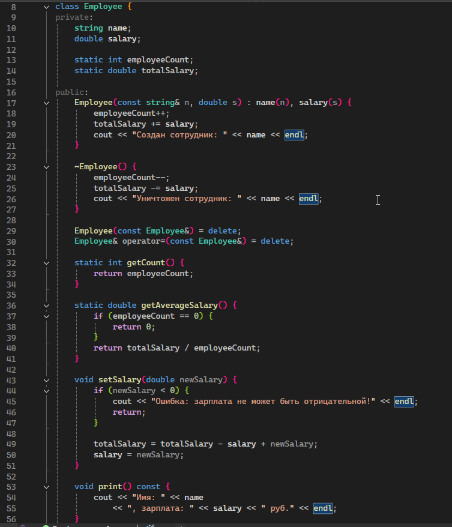
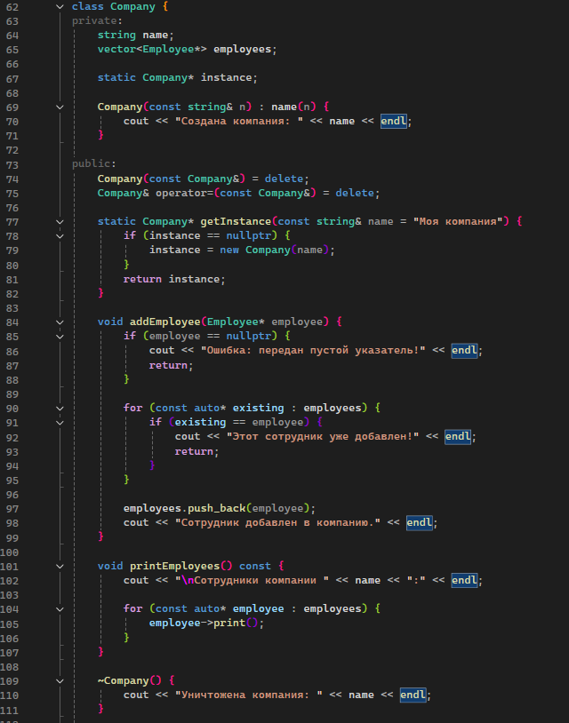
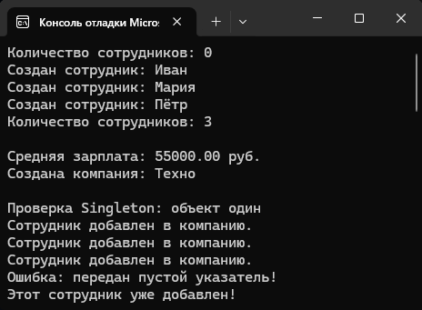
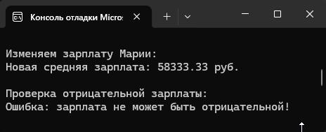
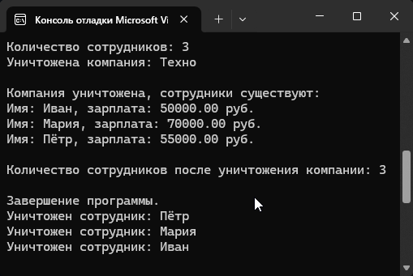

# Лабораторная работа №1: Композиция и агрегация классов. Статические члены

**Студент:** Рудик Аджамян  
**Группа:** ПИЖ-б-о-25-2(1)  
**Дисциплина:** Информационные технологии и программирование  
**Вариант:** 3  
**Уровень:** Продвинутый  
**Тема индивидуального задания:** Система учёта сотрудников: `Company` (одиночка) + `Employee` (агрегация). Подсчёт сотрудников и средней зарплаты.

**Проверила:** Белик Ангелина Игоревна
  

## 1. Цель работы 
1. Научиться проектировать отношения между классами:
композицию, агрегацию и ассоциацию
2. Освоить реализацию композиции (поля-объекты, вложение
структур) и агрегации (указатели, ссылки)
3. Понять разницу между композицией и агрегацией с точки зрения
времени жизни объектов
4. Научиться использовать статические поля и методы для подсчёта
объектов и реализации общих данных для всех экземпляров класса
5. Получить навыки правильного управления памятью при разных
типах отношений между классами

## 2. Индивидуальное задание

Согласно индивидуальному заданию, вариант 3 продвинутого уровня, необходимо разработать систему учёта сотрудников со следующими требованиями:

1. Реализовать класс `Company` по паттерну «Одиночка» (Singleton), обеспечивающий доступ к единственному экземпляру системы учёта.
2. Реализовать класс `Employee`, описывающий сотрудника. Данные сотрудника должны включать как минимум имя и заработную плату.
3. Организовать агрегацию между `Company` и `Employee`: сотрудники создаются независимо от системы учёта, а `Company` хранит ссылки или указатели на них и не отвечает за их уничтожение.
4. Добавить статические данные для подсчёта количества сотрудников и вычисления общей суммы заработной платы.
5. Реализовать статические методы для получения количества сотрудников и средней заработной платы.
6. Продемонстрировать добавление сотрудников, получение статистики, изменение заработной платы и сохранение существования сотрудников после завершения работы с объектом системы учёта.
7. Предусмотреть граничные случаи: отсутствие сотрудников, передача нулевого указателя, а также корректное обновление статистики при изменении зарплаты и уничтожении сотрудников.

## 3. Проектирование классов

### 3.1. Класс `Employee`

Класс `Employee` представляет отдельного сотрудника. Он хранит имя и заработную плату. При создании объекта обновляются общие статические показатели: количество сотрудников и сумма их зарплат. При уничтожении объекта эти показатели должны корректироваться. При изменении зарплаты необходимо обновить общую сумму, чтобы результат расчёта средней зарплаты оставался корректным.

   
Рисунок 1 - Класс Employee


### 3.2. Класс `Company`

Класс `Company` представляет систему учёта сотрудников. Он реализуется как Singleton и предоставляет доступ к единственному экземпляру. Для хранения сотрудников используется коллекция указателей или ссылок на объекты `Employee`, созданные независимо от `Company`. Это соответствует агрегации: уничтожение или завершение работы с `Company` не должно приводить к уничтожению сотрудников.

При добавлении сотрудника необходимо проверять указатель на значение `nullptr`. Следует также не допускать повторного добавления одного и того же сотрудника, если повторная запись приводит к дублированию данных в списке компании.

   
Рисунок 2 - Класс Company

### 3.3. Статистические показатели

В решении используются следующие общие показатели:

- количество существующих объектов `Employee`;
- суммарная заработная плата сотрудников;
- средняя заработная плата, вычисляемая как отношение общей суммы зарплат к количеству сотрудников.

Если количество сотрудников равно нулю, средняя зарплата должна возвращаться как `0`, чтобы избежать деления на ноль. Если зарплата изменяется, общая сумма должна изменяться на разницу между новым и старым значением.

## 4. Реализация программы

Ниже представлен исходный код программы, реализующий систему учёта сотрудников.

В коде реализованы следующие ключевые механизмы:
- **Паттерн Singleton:** класс `Company` имеет приватный конструктор, удалённый конструктор копирования и статический метод `getInstance()`, возвращающий единственный экземпляр.
- **Агрегация:** класс `Company` хранит вектор указателей `std::vector<Employee*>`, но не удаляет объекты `Employee` в своём деструкторе. Сотрудники создаются в функции `main` и существуют независимо от компании.
- **Статический подсчёт:** класс `Employee` содержит статические поля `employeeCount` и `totalSalary`, которые обновляются в конструкторе, деструкторе и методе изменения зарплаты `setSalary()`.
- **Обработка граничных случаев:** реализована проверка на `nullptr` при добавлении сотрудника, защита от повторного добавления одного и того же указателя, а также проверка на отрицательное значение зарплаты.

```cpp
#include <iostream>
#include <string>
#include <vector>
#include <iomanip>

using namespace std;

class Employee {
private:
    string name;
    double salary;

    static int employeeCount;
    static double totalSalary;

public:
    Employee(const string& n, double s) : name(n), salary(s) {
        employeeCount++;
        totalSalary += salary;
        cout << "Создан сотрудник: " << name << endl;
    }

    ~Employee() {
        employeeCount--;
        totalSalary -= salary;
        cout << "Уничтожен сотрудник: " << name << endl;
    }

    Employee(const Employee&) = delete;
    Employee& operator=(const Employee&) = delete;

    static int getCount() {
        return employeeCount;
    }

    static double getAverageSalary() {
        if (employeeCount == 0) {
            return 0;
        }
        return totalSalary / employeeCount;
    }

    void setSalary(double newSalary) {
        if (newSalary < 0) {
            cout << "Ошибка: зарплата не может быть отрицательной!" << endl;
            return;
        }

        totalSalary = totalSalary - salary + newSalary;
        salary = newSalary;
    }

    void print() const {
        cout << "Имя: " << name
            << ", зарплата: " << salary << " руб." << endl;
    }
};

int Employee::employeeCount = 0;
double Employee::totalSalary = 0;

class Company {
private:
    string name;
    vector<Employee*> employees;

    static Company* instance;

    Company(const string& n) : name(n) {
        cout << "Создана компания: " << name << endl;
    }

public:
    Company(const Company&) = delete;
    Company& operator=(const Company&) = delete;

    static Company* getInstance(const string& name = "Моя компания") {
        if (instance == nullptr) {
            instance = new Company(name);
        }
        return instance;
    }

    void addEmployee(Employee* employee) {
        if (employee == nullptr) {
            cout << "Ошибка: передан пустой указатель!" << endl;
            return;
        }

        for (const auto* existing : employees) {
            if (existing == employee) {
                cout << "Этот сотрудник уже добавлен!" << endl;
                return;
            }
        }

        employees.push_back(employee);
        cout << "Сотрудник добавлен в компанию." << endl;
    }

    void printEmployees() const {
        cout << "\nСотрудники компании " << name << ":" << endl;

        for (const auto* employee : employees) {
            employee->print();
        }
    }

    ~Company() {
        cout << "Уничтожена компания: " << name << endl;
    }

    static void destroyInstance() {
        delete instance;
        instance = nullptr;
    }
};

Company* Company::instance = nullptr;

int main() {
    setlocale(LC_ALL, "Russian");
    cout << fixed << setprecision(2);

    cout << "Количество сотрудников: "
        << Employee::getCount() << endl;

    Employee e1("Иван", 50000);
    Employee e2("Мария", 60000);
    Employee e3("Пётр", 55000);

    cout << "\nКоличество сотрудников: "
        << Employee::getCount() << endl;
    cout << "Средняя зарплата: "
        << Employee::getAverageSalary() << " руб." << endl;

    {
        Company* c1 = Company::getInstance("Техно");
        Company* c2 = Company::getInstance("Другая компания");

        cout << "\nПроверка Singleton: "
            << (c1 == c2 ? "объект один" : "объекты разные")
            << endl;

        c1->addEmployee(&e1);
        c1->addEmployee(&e2);
        c1->addEmployee(&e3);

        c1->addEmployee(nullptr);

        c1->addEmployee(&e1);

        c1->printEmployees();

        cout << "\nИзменяем зарплату Марии:" << endl;
        e2.setSalary(70000);

        cout << "Новая средняя зарплата: "
            << Employee::getAverageSalary() << " руб." << endl;

        cout << "\nПроверка отрицательной зарплаты:" << endl;
        e2.setSalary(-1000);

        cout << "\nКоличество сотрудников: "
            << Employee::getCount() << endl;

        Company::destroyInstance();
    }

    cout << "\nКомпания уничтожена, сотрудники существуют:" << endl;
    e1.print();
    e2.print();
    e3.print();

    cout << "\nКоличество сотрудников после уничтожения компании: "
        << Employee::getCount() << endl;

    cout << "\nЗавершение программы." << endl;
    return 0;
}
```

## 5. Результаты работы программы

Ниже приведены скриншоты работы программы, подтверждающие выполнение всех требований индивидуального задания.

   
**Рисунок 3 — `img-3.png`.** Создание сотрудников, проверка Singleton и добавление их в компанию.


   
**Рисунок 4 — `img-4.png`.** Изменение заработной платы сотрудника, пересчет средней зарплаты и проверка отрицательного значения.


   
**Рисунок 5 — `img-5.png`.** Демонстрация агрегации: сотрудники продолжают существовать и выводятся на экран после уничтожения компании.

## 6. Вывод

В ходе лабораторной работы рассматриваются отношения между классами в объектно-ориентированном программировании, в частности агрегация, при которой объекты-части существуют независимо от объекта-целого. На примере системы учёта сотрудников изучаются принципы реализации Singleton для класса `Company`, использование статических полей для подсчёта количества сотрудников и суммарной заработной платы, а также статических методов для получения общей статистики.

Практическая реализация позволяет закрепить навыки проектирования классов, управления временем жизни объектов, проверки указателей и обработки граничных случаев. Для завершения отчёта необходимо добавить исходный код в репозиторий, вставить реальные скриншоты выполнения программы и указать ссылку на опубликованный репозиторий.

## 7. Ответы на контрольные вопросы

### 1. Что такое композиция? Приведите пример.

Композиция — это отношение «целое — часть», при котором часть не существует независимо от целого в рамках данной модели. Целое отвечает за создание и время жизни частей. Например, объект `House` может содержать объекты `Room`: при уничтожении дома его комнаты также уничтожаются. В C++ композицию можно реализовать полями-объектами или умными указателями, которыми владеет объект-целое.

### 2. Что такое агрегация? Чем она отличается от композиции?

Агрегация — это отношение между целым и частью, при котором часть может существовать независимо от целого. Например, система `Company` может хранить указатели на объекты `Employee`, созданные вне компании. Уничтожение `Company` не должно уничтожать сотрудников. При композиции, напротив, время жизни частей связано с временем жизни целого, а при агрегации объекты-части имеют независимое время жизни.

### 3. Как реализовать композицию в C++? Приведите пример кода.

Композицию можно реализовать, включив объект одного класса в качестве поля другого класса. Например, класс `House` может содержать поле `Room`. В таком случае объект комнаты создаётся как часть объекта дома и автоматически уничтожается при уничтожении дома. Другой способ — использовать `std::unique_ptr`, если часть создаётся динамически и принадлежит целому. Важно обеспечить однозначное владение и не допускать утечек памяти.

### 4. Как реализовать агрегацию в C++? Приведите пример кода.

Агрегацию можно реализовать с помощью указателя или ссылки на объект, который создаётся и управляется независимо. Например, `Company` хранит указатели на объекты `Employee`, созданные в другом месте программы. Компания может обращаться к сотрудникам, но не должна удалять их в своём деструкторе. Перед использованием указателя следует проверить, что он не равен `nullptr`, а время жизни сотрудника должно быть достаточным для безопасного обращения к нему.

### 5. В чём разница между временем жизни частей при композиции и агрегации?

При композиции время жизни части зависит от времени жизни целого: когда уничтожается целое, уничтожаются и его части. При агрегации часть существует независимо, поэтому может пережить объект-целое. Эта разница влияет на выбор способа хранения объектов и на то, какой класс отвечает за освобождение памяти.

### 6. Что такое статическое поле класса? Чем оно отличается от обычного поля?

Статическое поле принадлежит классу в целом и является общим для всех экземпляров этого класса. Обычное поле принадлежит конкретному объекту, поэтому каждый экземпляр имеет собственное значение. Статическое поле удобно использовать для хранения количества объектов или общей суммы зарплат, а обычные поля — для имени и зарплаты конкретного сотрудника.

### 7. Как объявить и определить статическое поле? Где оно хранится?

Статическое поле объявляется внутри класса с ключевым словом `static`. В традиционном варианте C++ его определяют вне класса, чтобы выделить для него единое хранилище. Для статических полей, объявленных как `inline static` в C++17 и новее, отдельное определение вне класса обычно не требуется. Такое поле существует независимо от количества созданных экземпляров и хранит одно общее значение в течение соответствующего времени жизни программы.

### 8. Что такое статический метод? Можно ли из него обратиться к нестатическим полям?

Статический метод — это метод, который принадлежит классу, а не конкретному объекту. Его можно вызвать через имя класса без создания экземпляра. У статического метода нет указателя `this`, поэтому он не может напрямую обратиться к нестатическим полям, поскольку для этого требуется конкретный объект. При этом статический метод может обращаться к статическим полям и вызывать другие статические методы.

### 9. Для чего используются статические счётчики объектов?

Статические счётчики применяются для хранения общего количества объектов определённого класса. При создании объекта счётчик увеличивается, а при уничтожении уменьшается. В данной работе такой механизм позволяет получать количество существующих сотрудников. Чтобы значение оставалось корректным, необходимо учитывать копирование и перемещение объектов, а также не допускать двойного обновления счётчика.

### 10. Что такое паттерн «Одиночка» (Singleton)? Для чего он нужен?

Singleton — это паттерн проектирования, который обеспечивает наличие единственного экземпляра класса и предоставляет общую точку доступа к нему. Он может быть полезен для системы учёта, которая должна представляться одним общим объектом `Company`. Обычно конструктор такого класса ограничивают, а доступ к экземпляру предоставляют через статический метод. При реализации следует также запретить копирование, если оно может привести к появлению дополнительных экземпляров.

### 11. Как запретить создание копий объекта (конструктор копирования)?

В C++ копирование можно запретить, объявив конструктор копирования и оператор копирующего присваивания удалёнными с помощью `= delete`. Например, для Singleton это не позволяет создавать копии единственного экземпляра. Аналогично можно запретить операции перемещения, если они также нарушают выбранную модель владения или уникальности.

### 12. В каком порядке вызываются конструкторы и деструкторы при композиции?

При создании объекта сначала конструируются его базовые классы и поля-члены в порядке объявления, после чего выполняется тело конструктора самого объекта. При уничтожении порядок обратный: сначала выполняется тело деструктора целого, затем уничтожаются его поля-члены в обратном порядке их объявления, после чего уничтожаются базовые классы. Поэтому при композиции части автоматически уничтожаются вместе с целым.

### 13. Можно ли изменить статическое поле из обычного метода?

Да. Обычный метод может изменять статическое поле, если имеет к нему доступ с учётом правил `private`, `protected` и `public`. Например, метод изменения зарплаты сотрудника может скорректировать общую сумму зарплат. При этом изменение должно выполняться согласованно, чтобы статистика не расходилась с данными отдельных объектов.

### 14. Почему статические поля нужно определять вне класса?

В традиционном варианте C++ объявление статического поля внутри класса сообщает компилятору о его существовании, но само по себе не всегда создаёт единственное определение, необходимое для хранения поля. Поэтому поле обычно определяют вне класса. Исключение составляют, в частности, поля, объявленные `inline static` в C++17 и новее, для которых отдельное определение не требуется.

### 15. В каких случаях стоит использовать композицию, а в каких — агрегацию?

Композицию следует использовать, когда объект-целое владеет частями и отвечает за их жизненный цикл. Примеры — комнаты в модели дома или элементы, существование которых полностью зависит от контейнера. Агрегация подходит, когда объекты должны оставаться самостоятельными и могут использоваться разными объектами-целыми. В данной работе сотрудники создаются независимо от системы `Company`, поэтому агрегация позволяет им существовать и после завершения работы с системой учёта.

