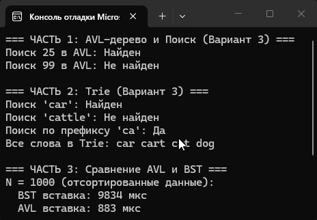

# Лабораторная работа №10: AVL-дерево. Префиксное дерево (Trie)

**Студент:** Аджамян Рудик Агаронович  
**Группа:** ПИЖ-б-о-25-2(1)  
**Дисциплина:** Алгоритмы и структура данных  
**Вариант:** 3  
**Тема индивидуального задания:** AVL-дерево (поиск элемента) и Trie (получение всех слов).

**Проверила:** Белик Ангелина Игоревна  

## 1. Цель работы  
1. Реализовать самобалансирующееся AVL-дерево с операциями вставки, удаления и поиска.
2. Освоить механизмы балансировки: малые и большие повороты.
3. Изучить структуру данных «префиксное дерево» (Trie).
4. Реализовать операции вставки, поиска и удаления в Trie.
5. Сравнить производительность AVL-дерева и обычного BST.

## 2. Теоретическая часть
**AVL-дерево** — это самобалансирующееся бинарное дерево поиска. Для каждого узла разница высот левого и правого поддеревьев (фактор баланса) не превышает 1 по модулю. Если баланс нарушается, выполняются повороты (малые и большие), чтобы вернуть дерево в равновесие. Это гарантирует высоту O(log n) и быстрый поиск.
**Trie (префиксное дерево)** — структура данных для хранения строк. Каждый узел представляет собой один символ. Слова, имеющие общий префикс, находятся в одной ветке. Позволяет искать строки и префиксы за O(L), где L — длина строки.

## 3. Постановка задачи (Вариант 3)
**Часть 1:** Реализовать AVL-дерево (вставка с балансировкой) и метод поиска элемента.
**Часть 2:** Реализовать Trie (вставка, поиск, поиск по префиксу) и метод получения всех слов.
**Часть 3:** Сравнить производительность вставки в AVL и BST на массивах из 1000, 5000 и 10000 элементов, отсортированных по возрастанию (худший случай для BST).

## 4. Листинг программы
~~~cpp
#include <iostream>
#include <string>
#include <vector>
#include <chrono>
#include <algorithm>
#include <cstdlib>
#include <ctime>

using namespace std;
using namespace chrono;

struct AVLNode {
    int key;
    AVLNode* left;
    AVLNode* right;
    int height;
    AVLNode(int k) : key(k), left(nullptr), right(nullptr), height(1) {}
};

class AVLTree {
private:
    AVLNode* root;

    int height(AVLNode* node) {
        return node ? node->height : 0;
    }

    int balanceFactor(AVLNode* node) {
        return height(node->left) - height(node->right);
    }

    void updateHeight(AVLNode* node) {
        node->height = 1 + max(height(node->left), height(node->right));
    }

    AVLNode* rightRotate(AVLNode* y) {
        AVLNode* x = y->left;
        AVLNode* T2 = x->right;
        x->right = y;
        y->left = T2;
        updateHeight(y);
        updateHeight(x);
        return x;
    }

    AVLNode* leftRotate(AVLNode* x) {
        AVLNode* y = x->right;
        AVLNode* T2 = y->left;
        y->left = x;
        x->right = T2;
        updateHeight(x);
        updateHeight(y);
        return y;
    }

    AVLNode* balance(AVLNode* node) {
        if (node == nullptr) return nullptr;
        updateHeight(node);
        int bf = balanceFactor(node);

        if (bf > 1) {
            if (balanceFactor(node->left) < 0) {
                node->left = leftRotate(node->left);
            }
            return rightRotate(node);
        }
        else if (bf < -1) {
            if (balanceFactor(node->right) > 0) {
                node->right = rightRotate(node->right);
            }
            return leftRotate(node);
        }
        return node;
    }

    AVLNode* insert(AVLNode* node, int key) {
        if (node == nullptr) return new AVLNode(key);
        if (key < node->key) node->left = insert(node->left, key);
        else if (key > node->key) node->right = insert(node->right, key);
        else return node;
        return balance(node);
    }

    bool search(AVLNode* node, int key) {
        if (node == nullptr) return false;
        if (key == node->key) return true;
        if (key < node->key) return search(node->left, key);
        return search(node->right, key);
    }

public:
    AVLTree() : root(nullptr) {}
    
    void insert(int key) { root = insert(root, key); }
    bool search(int key) { return search(root, key); }
};

struct BSTNode {
    int key;
    BSTNode* left;
    BSTNode* right;
    BSTNode(int k) : key(k), left(nullptr), right(nullptr) {}
};

class BST {
private:
    BSTNode* root;

    BSTNode* insert(BSTNode* node, int key) {
        if (node == nullptr) return new BSTNode(key);
        if (key < node->key) node->left = insert(node->left, key);
        else if (key > node->key) node->right = insert(node->right, key);
        return node;
    }

    bool search(BSTNode* node, int key) {
        if (node == nullptr) return false;
        if (key == node->key) return true;
        if (key < node->key) return search(node->left, key);
        return search(node->right, key);
    }

public:
    BST() : root(nullptr) {}
    void insert(int key) { root = insert(root, key); }
    bool search(int key) { return search(root, key); }
};

class Trie {
private:
    struct TrieNode {
        TrieNode* children[26];
        bool isEndOfWord;
        TrieNode() : isEndOfWord(false) {
            for (int i = 0; i < 26; i++) children[i] = nullptr;
        }
    };
    TrieNode* root;

    void collectWords(TrieNode* node, string current, vector<string>& result) {
        if (node->isEndOfWord) result.push_back(current);
        for (int i = 0; i < 26; i++) {
            if (node->children[i] != nullptr) {
                collectWords(node->children[i], current + char('a' + i), result);
            }
        }
    }

public:
    Trie() : root(new TrieNode()) {}

    void insert(const string& word) {
        TrieNode* current = root;
        for (char ch : word) {
            int index = ch - 'a';
            if (current->children[index] == nullptr) {
                current->children[index] = new TrieNode();
            }
            current = current->children[index];
        }
        current->isEndOfWord = true;
    }

    bool search(const string& word) {
        TrieNode* current = root;
        for (char ch : word) {
            int index = ch - 'a';
            if (current->children[index] == nullptr) return false;
            current = current->children[index];
        }
        return current->isEndOfWord;
    }

    bool startsWith(const string& prefix) {
        TrieNode* current = root;
        for (char ch : prefix) {
            int index = ch - 'a';
            if (current->children[index] == nullptr) return false;
            current = current->children[index];
        }
        return true;
    }

    vector<string> getAllWords() {
        vector<string> result;
        collectWords(root, "", result);
        return result;
    }
};

int main() {
    setlocale(LC_ALL, "ru");
    srand(time(0));

    cout << "=== ЧАСТЬ 1: AVL-дерево и Поиск (Вариант 3) ===" << endl;
    AVLTree avl;
    avl.insert(10);
    avl.insert(20);
    avl.insert(30);
    avl.insert(40);
    avl.insert(50);
    avl.insert(25);
    cout << "Поиск 25 в AVL: " << (avl.search(25) ? "Найден" : "Не найден") << endl;
    cout << "Поиск 99 в AVL: " << (avl.search(99) ? "Найден" : "Не найден") << endl << endl;

    cout << "=== ЧАСТЬ 2: Trie (Вариант 3) ===" << endl;
    Trie trie;
    trie.insert("cat");
    trie.insert("car");
    trie.insert("cart");
    trie.insert("dog");
    
    cout << "Поиск 'car': " << (trie.search("car") ? "Найден" : "Не найден") << endl;
    cout << "Поиск 'cattle': " << (trie.search("cattle") ? "Найден" : "Не найден") << endl;
    cout << "Поиск по префиксу 'ca': " << (trie.startsWith("ca") ? "Да" : "Нет") << endl;
    
    cout << "Все слова в Trie: ";
    vector<string> words = trie.getAllWords();
    for (const string& w : words) cout << w << " ";
    cout << endl << endl;

    cout << "=== ЧАСТЬ 3: Сравнение AVL и BST ===" << endl;
    int sizes[] = {1000, 5000, 10000};
    
    for (int n : sizes) {
        AVLTree avlTree;
        BST bstTree;

        vector<int> sortedData(n);
        for (int i = 0; i < n; i++) sortedData[i] = i;

        auto start = high_resolution_clock::now();
        for (int i = 0; i < n; i++) bstTree.insert(sortedData[i]);
        auto end = high_resolution_clock::now();
        long long bstTime = duration_cast<microseconds>(end - start).count();

        start = high_resolution_clock::now();
        for (int i = 0; i < n; i++) avlTree.insert(sortedData[i]);
        end = high_resolution_clock::now();
        long long avlTime = duration_cast<microseconds>(end - start).count();

        cout << "N = " << n << " (отсортированные данные):" << endl;
        cout << "  BST вставка: " << bstTime << " мкс" << endl;
        cout << "  AVL вставка: " << avlTime << " мкс" << endl;
    }

    return 0;
}
~~~

## 5. Результаты работы программы

   
**Рисунок 1 — `img-1.png`.** Демонстрация поиска в AVL-дереве, работы с Trie и сравнения времени вставки AVL и BST.

## 6. Анализ сложности операций

**AVL-дерево:**
*   Вставка: **O(log n)**.
*   Поиск: **O(log n)**.
*   Удаление: **O(log n)**.
AVL-дерево гарантирует логарифмическую сложность в любом случае благодаря балансировке.

**Trie (Префиксное дерево):**
*   Вставка: **O(L)**, где L — длина слова.
*   Поиск: **O(L)**.
*   Поиск по префиксу: **O(L)**.

**Результат эксперимента:**
При вставке элементов, уже отсортированных по возрастанию, обычное BST вырождается в связный список. Его сложность вставки падает до O(n), и время выполнения резко возрастает. В то же время AVL-дерево с помощью поворотов поддерживает баланс, и его время вставки остается на уровне O(log n). В таблице видно, что на массиве из 10 000 элементов AVL-дерево вставляет элементы значительно быстрее, чем вырожденное BST.

## 7. Вывод
В ходе работы были изучены и реализованы AVL-дерево и префиксное дерево (Trie). AVL-дерево решает проблему вырождения обычного BST, гарантируя логарифмическую сложность операций за счет выполнения поворотов при дисбалансе. Trie показало себя как эффективная структура для хранения строк, позволяющая быстро искать слова и префиксы. Сравнительный эксперимент наглядно доказал преимущество AVL-дерева над BST при работе с отсортированными данными.

## 8. Ответы на контрольные вопросы

### 1. Что такое AVL-дерево? В чём его отличие от обычного BST?
AVL-дерево — это сбалансированное бинарное дерево поиска. Отличие от обычного BST в том, что AVL автоматически поддерживает баланс высот поддеревьев (разница не более 1), гарантируя высоту O(log n). Обычное BST может выродиться в список с высотой O(n).

### 2. Что такое фактор баланса? Как он вычисляется?
Это разница между высотой левого и правого поддеревьев узла. Вычисляется как `height(left) - height(right)`. Для AVL-дерева он должен принимать значения -1, 0 или 1.

### 3. Какие существуют типы поворотов в AVL-дереве?
1. Малый правый поворот (Left-Left case).
2. Малый левый поворот (Right-Right case).
3. Большой левый-правый поворот (Left-Right case).
4. Большой правый-левый поворот (Right-Left case).

### 4. Когда применяется правый поворот? Левый поворот?
**Правый** применяется, когда левое поддерево выше правого (фактор баланса > 1) и левый потомок сбалансирован или перевешивает влево.
**Левый** применяется, когда правое поддерево выше (фактор баланса < -1) и правый потомок сбалансирован или перевешивает вправо.

### 5. Когда применяется левый-правый поворот? Правый-левый?
**Левый-правый** применяется, если левое поддерево выше (bf > 1), но его правый потомок имеет большее правое поддерево (bf левого потомка < 0).
**Правый-левый** — если правое поддерево выше (bf < -1), но его левый потомок имеет большее левое поддерево.

### 6. Какова сложность операций в AVL-дереве?
Все операции (поиск, вставка, удаление) выполняются за **O(log n)** в лучшем, среднем и худшем случаях.

### 7. Почему AVL-дерево называется самобалансирующимся?
Потому что после каждой операции вставки или удаления оно автоматически проверяет факторы баланса и, если нужно, выполняет повороты, чтобы вернуть дерево в сбалансированное состояние.

### 8. Как часто происходит балансировка при вставке?
Не чаще, чем один раз на каждый уровень дерева. В среднем достаточно 1-2 поворотов на всю операцию вставки.

### 9. Чем AVL-дерево отличается от красно-чёрного дерева?
AVL-дерево строго сбалансировано (разница высот ≤ 1), поэтому поиск работает чуть быстрее. Красно-чёрное дерево менее строгое к балансу, поэтому вставка/удаление требуют меньше поворотов, и оно часто используется в стандартных библиотеках (например, `std::map`).

### 10. В каких случаях AVL-дерево эффективнее BST?
В случаях, когда данные поступают в отсортированном или почти отсортированном виде, либо когда операций поиска значительно больше, чем операций вставки.

### 11. Что такое Trie (префиксное дерево)? Для решения каких задач оно используется?
Это дерево, где каждый узел представляет собой символ. Используется для автодополнения (поиска по префиксу), проверки орфографии, словарей и IP-маршрутизации.

### 12. Какова сложность поиска в Trie? От чего она зависит?
Сложность **O(L)**, где L — длина искомого слова. Она зависит только от длины строки и не зависит от количества слов в словаре.

### 13. Какая структура данных эффективнее для строк: Trie или хеш-таблица?
Для точного поиска строки хеш-таблица быстрее (O(1)). Но для поиска по префиксу или вывода всех слов по алфавиту Trie эффективнее, так как он хранит строки посимвольно в древовидной структуре.

### 14. Как реализовать автодополнение с помощью Trie?
Сначала нужно найти узел, соответствующий введенному префиксу (функция `startsWith`). Затем с помощью обхода (например, DFS) собрать все слова, которые начинаются с этого узла.

### 15. Каковы недостатки Trie? Какой объём памяти он требует?
Главный недостаток — **высокое потребление памяти**. Каждый узел содержит массив указателей на 26 (или более) символов. Если слов много, а алфавит большой, памяти расходуется значительно больше, чем при хранении тех же слов в массиве или хеш-таблице.