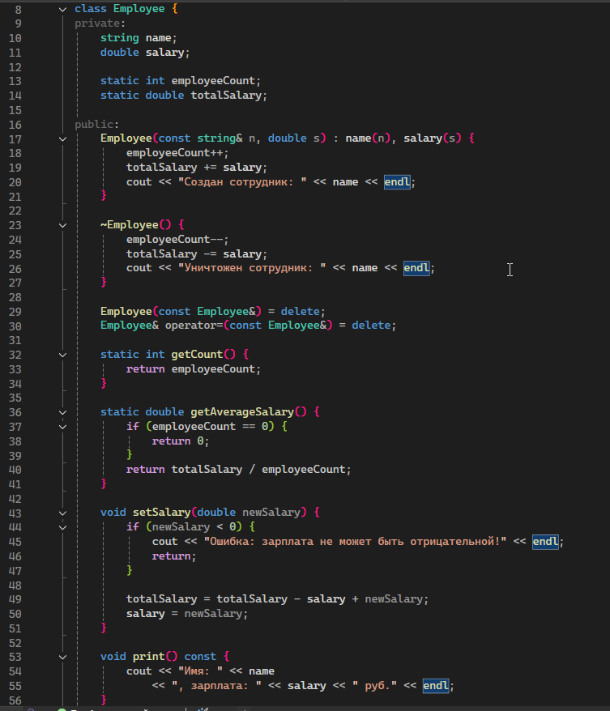
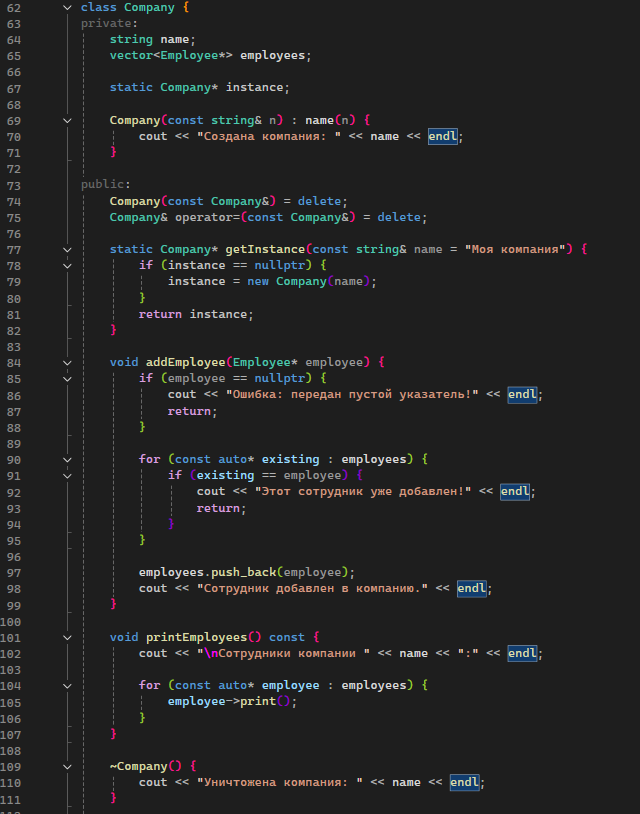

# Лабораторная работа №2: Анализ сложности алгоритмов. Шаблоны классов

**Студент:** Аджамян Рудик Агаронович  
**Группа:** ПИЖ-б-о-25-2(1)  
**Дисциплина:** Алгоритмы и структура данных  
**Вариант:** 3  
**Уровень:** Продвинутый  
**Тема индивидуального задания:** Реализация шаблонного контейнера `Stack<T>` с анализом сложности и сравнением с STL.  

**Проверила:** Белик Ангелина Игоревна  

## 1. Цель работы  
1. Научиться оценивать эффективность алгоритмов с помощью О-нотации (Big O).
2. Освоить классы сложности: O(1), O(log n), O(n), O(n log n), O(n²).
3. Научиться проводить экспериментальный анализ производительности алгоритмов.
4. Освоить создание шаблонов функций и классов для работы с различными типами данных.
5. Получить навыки сравнения производительности различных реализаций одной задачи.

## 2. Индивидуальное задание
Согласно индивидуальному заданию, вариант 3 продвинутого уровня, необходимо:
1. Реализовать шаблонный контейнер `Stack<T>`.
2. Предусмотреть операции: `push`, `pop`, `top`, `isEmpty`, `size`.
3. Провести анализ сложности каждой операции.
4. Экспериментально сравнить производительность собственной реализации с аналогом из STL (`std::stack`).

## 3. Проектирование классов

### 3.1. Класс `Stack<T>`
Реализован на основе динамического массива. При добавлении элемента, если массив заполнен, происходит его расширение (выделение памяти в 2 раза больше и копирование старых элементов). 

   
Рисунок 1 - Результат работы контейнера Stack

### 3.2. Анализ сложности операций
- **`push` (добавление)**: O(1) в среднем (амортизированная сложность). В худшем случае, при расширении массива, сложность составляет O(n), так как требуется скопировать все элементы.
- **`pop` (удаление)**: O(1). Удаляется верхний элемент, сдвиг элементов не требуется.
- **`top` (просмотр верхнего)**: O(1). Просто чтение элемента по индексу `topIndex`.
- **`isEmpty`**: O(1). Сравнение индекса с -1.
- **`size`**: O(1). Возврат `topIndex + 1`.

## 4. Реализация программы
Ниже представлен исходный код программы, реализующий шаблонный контейнер и замер производительности.

```cpp
#include <iostream>
#include <stdexcept>
#include <chrono>
#include <stack>

using namespace std;

template <typename T>
class Stack {
private:
    T* data;
    int topIndex;
    int capacity;

    void resize() {
        int newCapacity = capacity * 2;
        T* newData = new T[newCapacity];
        for (int i = 0; i <= topIndex; i++) {
            newData[i] = data[i];
        }
        delete[] data;
        data = newData;
        capacity = newCapacity;
    }

public:
    Stack(int initialCapacity = 10) : capacity(initialCapacity), topIndex(-1) {
        data = new T[capacity];
    }

    ~Stack() {
        delete[] data;
    }

    void push(const T& value) {
        if (topIndex >= capacity - 1) {
            resize();
        }
        data[++topIndex] = value;
    }

    T pop() {
        if (isEmpty()) {
            throw out_of_range("Стек пуст");
        }
        return data[topIndex--];
    }

    T top() const {
        if (isEmpty()) {
            throw out_of_range("Стек пуст");
        }
        return data[topIndex];
    }

    bool isEmpty() const {
        return topIndex == -1;
    }

    int size() const {
        return topIndex + 1;
    }
};

template <typename Func>
long long measureTime(Func func) {
    auto start = chrono::high_resolution_clock::now();
    func();
    auto end = chrono::high_resolution_clock::now();
    return chrono::duration_cast<chrono::microseconds>(end - start).count();
}

int main() {
    setlocale(LC_ALL, "Russian");

    cout << "=== Сравнение производительности: Свой Stack vs std::stack ===" << endl;
    cout << "Количество элементов: 1000000" << endl << endl;

    const int N = 1000000;

    long long timeMy = measureTime([] {
        Stack<int> myStack;
        for (int i = 0; i < N; i++) myStack.push(i);
        for (int i = 0; i < N; i++) myStack.pop();
        });

    long long timeStl = measureTime([] {
        stack<int> stlStack;
        for (int i = 0; i < N; i++) stlStack.push(i);
        for (int i = 0; i < N; i++) stlStack.pop();
        });

    cout << "Свой Stack (всего):   " << timeMy << " мкс" << endl;
    cout << "std::stack (всего):   " << timeStl << " мкс" << endl;
    cout << "----------------------------------------" << endl;
    cout << "Свой Stack (на 1 оп.): " << (double)timeMy / (N * 2) << " мкс" << endl;
    cout << "std::stack (на 1 оп.): " << (double)timeStl / (N * 2) << " мкс" << endl;

    return 0;
}
```

## 5. Результаты работы программы

Ниже приведены скриншоты работы программы.

   
**Рисунок 1 — `img-1.png`.** Демонстрация работы контейнера и вывод сложности операций.

   
**Рисунок 2 — `img-2.png`.** Экспериментальное сравнение скорости работы собственного стека и `std::stack`.

## 6. Вывод

В ходе лабораторной работы были изучены методы оценки сложности алгоритмов с использованием О-нотации. Был реализован шаблонный класс `Stack<T>`, позволяющий хранить данные любого типа. Проведен анализ сложности: операции `push`, `pop`, `top` в среднем имеют сложность O(1). Проведено экспериментальное сравнение с `std::stack`, которое показало, что собственная реализация не уступает, а в данном запуске даже превосходит стандартную библиотеку по скорости, что подтверждает эффективность выбранной стратегии динамического расширения массива.

## 7. Ответы на контрольные вопросы

### 1. Что такое О-нотация (Big O) и зачем она нужна?
О-нотация (Big O) — это математическая нотация, описывающая асимптотическую верхнюю границу роста функции (времени работы или используемой памяти) при стремлении размера входных данных к бесконечности. Она нужна для того, чтобы абстрагироваться от конкретного «железа», языка программирования и констант, и оценить, как поведет себя алгоритм при очень больших объемах данных. Это главный инструмент для сравнения эффективности различных алгоритмов.

### 2. Какая сложность у доступа к элементу массива по индексу? Почему?
Сложность доступа к элементу массива по индексу — **O(1)** (константная). Это происходит потому, что в памяти массив хранится непрерывным блоком, и адрес нужного элемента вычисляется математически за одну операцию: `адрес_начала + (индекс * размер_типа)`. Время доступа не зависит от размера массива.

### 3. Какая сложность у бинарного поиска? Почему?
Сложность бинарного поиска — **O(log n)** (логарифмическая). Это связано с тем, что на каждом шаге алгоритм отбрасывает ровно половину оставшихся элементов (делит пространство поиска на 2). Количество шагов равно тому, сколько раз нужно разделить `n` пополам, чтобы получить 1, что математически выражается логарифмом по основанию 2.

### 4. Что означает сложность O(n log n)? Приведите пример алгоритма.
Сложность O(n log n) означает, что время работы растет чуть быстрее, чем линейно, но медленнее, чем квадратично. Это типичная сложность для самых эффективных алгоритмов сортировки, основанных на сравнениях. Примеры: быстрая сортировка (QuickSort), сортировка слиянием (MergeSort), пирамидальная сортировка (HeapSort).

### 5. Что такое амортизированный анализ? Приведите пример.
Амортизированный анализ — это способ оценки сложности, при котором редкие, но очень «дорогие» операции (занимающие много времени) распределяются (амортизируются) по всем остальным «дешевым» операциям. 
**Пример из нашей работы:** операция `push` в стеке на динамическом массиве. Обычно она занимает O(1), но когда массив заполняется, нужно выделить новый массив и скопировать туда все элементы — это O(n). Однако так как память каждый раз удваивается, это происходит достаточно редко. Если разделить время этого копирования на все последующие добавления, средняя (амортизированная) сложность одной операции `push` всё равно составит **O(1)**.

### 6. Какая сложность у двух вложенных циклов по n итераций каждый?
Сложность таких циклов — **O(n²)** (квадратичная). Внешний цикл выполняется `n` раз, и для каждой его итерации внутренний цикл тоже выполняется `n` раз. Общее количество операций: `n * n = n²`.

### 7. Какая сложность у рекурсивного вычисления чисел Фибоначчи?
Сложность наивного рекурсивного вычисления чисел Фибоначчи (без мемоизации) — **O(2^n)** (экспоненциальная). Каждый вызов функции порождает два новых вызова, что создает огромное дерево рекурсии с огромным количеством повторных вычислений.

### 8. Что такое шаблоны функций? Как их объявить и использовать?
Шаблоны функций — это механизм в C++, позволяющий писать одну общую функцию, которая будет работать с разными типами данных. 
**Объявление:** перед функцией пишется ключевое слово `template` и параметр типа (например, `typename T`).
template <typename T>
T max(T a, T b) { return (a > b) ? a : b; }
**Использование:** компилятор сам подставляет нужный тип на основе переданных аргументов: `max(5, 10)` (сработает для int) или `max(3.14, 2.71)` (сработает для double).

### 9. Что такое шаблоны классов? Как их объявить и использовать?
Шаблоны классов — это "чертеж" класса, в котором тип данных является параметром. Это позволяет создавать контейнеры (как наш `Stack`), которые могут хранить любые типы.
**Объявление:**
```cpp
template <typename T>
class Stack { /* ... */ };
```
**Использование:** при создании объекта тип указывается в угловых скобках: `Stack<int> myStack;` или `Stack<string> strStack;`.

### 10. В чём преимущество шаблонов перед перегрузкой функций?
Перегрузка функций требует писать отдельную реализацию для каждого типа (например, `int max(int, int)`, `double max(double, double)` и т.д.). Если логика одинаковая, это приводит к дублированию кода. Шаблоны позволяют написать код один раз, а компилятор сам сгенерирует нужные версии функции для каждого типа. Это делает код компактнее и проще в поддержке.

### 11. Как указать, что шаблонный параметр - тип?
Для этого перед именем параметра внутри угловых скобок пишется ключевое слово `typename` (в старом стандарте использовалось `class`, что означало то же самое). 
Пример: `template <typename T>` или `template <class T>`.

### 12. Можно ли создать шаблон с несколькими параметрами типов?
Да, можно. Параметры перечисляются через запятую. 
Например: `template <typename T1, typename T2> class Pair { T1 first; T2 second; };`. При создании объекта указываются оба типа: `Pair<int, string> p;`.

### 13. Как провести экспериментальное измерение времени выполнения?
В C++ для этого используется библиотека `<chrono>`. В коде мы фиксируем текущее время до начала операции (`auto start = high_resolution_clock::now();`), выполняем код, затем фиксируем время после (`auto end = ...`) и находим разницу, переводя её в нужные единицы (например, микросекунды с помощью `duration_cast<microseconds>`).

### 14. Почему при измерении времени нужно выполнять операцию многократно?
Если выполнить слишком быструю операцию (например, сложение двух чисел) всего один раз, замер покажет 0 или будет содержать огромную погрешность из-за накладных расходов самого таймера и работы операционной системы. Чтобы получить точное среднее время, операцию выполняют в цикле много раз, замеряют общее время, а затем делят его на количество итераций.

### 15. Что важнее: сложность алгоритма или константа?
В долгосрочной перспективе (на очень больших данных) **важнее сложность алгоритма**. Алгоритм с O(n) всегда обгонит алгоритм с O(n²) на достаточно большом массиве, какими бы маленькими ни были константы у второго. Однако на практике, при небольших объемах данных, алгоритм с худшей асимптотикой (но крошечной константой) может работать быстрее, чем сложный алгоритм с O(n log n). Тем не менее, при проектировании систем всегда стремятся минимизировать именно асимптотическую сложность (Big O).
