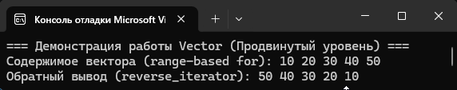
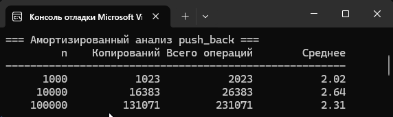

# Лабораторная работа №3: Реализация динамического массива (аналог vector). Итераторы

**Студент:** Аджамян Рудик Агаронович  
**Группа:** ПИЖ-б-о-25-2(1)  
**Дисциплина:** Алгоритмы и структура данных  
**Вариант:** 3 (Продвинутый уровень)  
**Тема индивидуального задания:** Реализация шаблонного класса `Vector<T>` с поддержкой `reverse_iterator` и методов `rbegin`, `rend`.

**Проверила:** Белик Ангелина Игоревна  

## 1. Цель работы  
1. Реализовать шаблонный класс `Vector<T>` — аналог `std::vector` — с нуля.
2. Освоить управление динамической памятью: выделение, расширение, освобождение.
3. Закрепить «правило трёх» и освоить «правило пяти».
4. Реализовать итераторы для поддержки range-based for и STL-совместимости.
6. Провести амортизированный анализ операции `push_back`.

## 2. Теоретическая часть
**Динамический массив** — это структура данных, память для которой выделяется в куче (heap) во время выполнения программы. В отличие от статических массивов, его размер можно изменять.

**Правило трёх:** если классу нужен собственный деструктор, конструктор копирования или оператор присваивания копированием, то, скорее всего, нужны все три (для предотвращения утечек памяти).
**Правило пяти:** добавляет к правилу трёх конструктор перемещения и оператор присваивания перемещением (для оптимизации работы с временными объектами).

**Итераторы** — объекты, ведущие себя как указатели. Позволяют перебирать элементы контейнера.

## 3. Постановка задачи
Согласно варианту 3 (продвинутый уровень), необходимо:
1. Реализовать класс `Vector` с полной поддержкой «правила пяти».
2. Реализовать стандартные итераторы (`begin`, `end`).
3. Реализовать `reverse_iterator` и методы `rbegin`, `rend` для перебора элементов в обратном порядке.
4. Провести экспериментальный анализ операции `push_back` (амортизированная сложность).

## 4. Листинг программы

```cpp
#include <iostream>
#include <stdexcept>
#include <iomanip>

using namespace std;

template <typename T>
class Vector {
private:
    T* data;
    int sz;
    int cap;
    int copyCount;

public:
    class reverse_iterator {
    private:
        T* ptr;
    public:
        reverse_iterator(T* p = nullptr) : ptr(p) {}
        T& operator*() { return *(ptr - 1); }
        const T& operator*() const { return *(ptr - 1); }
        reverse_iterator& operator++() { --ptr; return *this; }
        reverse_iterator operator++(int) { reverse_iterator temp = *this; --ptr; return temp; }
        bool operator!=(const reverse_iterator& other) const { return ptr != other.ptr; }
        bool operator==(const reverse_iterator& other) const { return ptr == other.ptr; }
    };

    Vector() : data(nullptr), sz(0), cap(0), copyCount(0) {}

    explicit Vector(int n) : sz(n), cap(n), copyCount(0) {
        data = new T[cap];
        for (int i = 0; i < sz; i++) data[i] = T();
    }

    Vector(int n, const T& val) : sz(n), cap(n), copyCount(0) {
        data = new T[cap];
        for (int i = 0; i < sz; i++) data[i] = val;
    }

    Vector(const Vector& other) : sz(other.sz), cap(other.cap), copyCount(other.copyCount) {
        data = new T[cap];
        for (int i = 0; i < sz; i++) data[i] = other.data[i];
    }

    Vector(Vector&& other) noexcept : data(other.data), sz(other.sz), cap(other.cap), copyCount(other.copyCount) {
        other.data = nullptr;
        other.sz = 0;
        other.cap = 0;
    }

    ~Vector() { delete[] data; }

    Vector& operator=(const Vector& other) {
        if (this != &other) {
            Vector temp(other);
            swap(temp);
        }
        return *this;
    }

    Vector& operator=(Vector&& other) noexcept {
        if (this != &other) {
            delete[] data;
            data = other.data;
            sz = other.sz;
            cap = other.cap;
            copyCount = other.copyCount;
            other.data = nullptr;
            other.sz = 0;
            other.cap = 0;
        }
        return *this;
    }

    void swap(Vector& other) noexcept {
        std::swap(data, other.data);
        std::swap(sz, other.sz);
        std::swap(cap, other.cap);
        std::swap(copyCount, other.copyCount);
    }

    T& operator[](int index) {
        if (index < 0 || index >= sz) throw out_of_range("Index out of range");
        return data[index];
    }

    const T& operator[](int index) const {
        if (index < 0 || index >= sz) throw out_of_range("Index out of range");
        return data[index];
    }

    int size() const { return sz; }
    int capacity() const { return cap; }
    bool empty() const { return sz == 0; }

    void reserve(int newCap) {
        if (newCap <= cap) return;
        T* newData = new T[newCap];
        for (int i = 0; i < sz; i++) {
            newData[i] = data[i];
            copyCount++;
        }
        delete[] data;
        data = newData;
        cap = newCap;
    }

    void push_back(const T& value) {
        if (sz >= cap) {
            int newCap = cap == 0 ? 1 : cap * 2;
            reserve(newCap);
        }
        data[sz++] = value;
    }

    void pop_back() {
        if (empty()) throw underflow_error("Vector is empty");
        sz--;
    }

    void clear() { sz = 0; }
    int getCopyCount() const { return copyCount; }
    void resetCopyCount() { copyCount = 0; }

    T* begin() { return data; }
    T* end() { return data + sz; }
    const T* begin() const { return data; }
    const T* end() const { return data + sz; }

    reverse_iterator rbegin() { return reverse_iterator(data + sz); }
    reverse_iterator rend() { return reverse_iterator(data); }
};

int main() {
    setlocale(LC_ALL, "ru");

    cout << "=== Демонстрация работы Vector (Продвинутый уровень) ===" << endl;
    Vector<int> v;

    for (int i = 1; i <= 5; i++) v.push_back(i * 10);

    cout << "Содержимое вектора (range-based for): ";
    for (int x : v) cout << x << " ";
    cout << endl;

    cout << "Обратный вывод (reverse_iterator): ";
    for (auto it = v.rbegin(); it != v.rend(); ++it) {
        cout << *it << " ";
    }
    cout << endl;

    cout << "\n=== Амортизированный анализ push_back ===" << endl;
    cout << setw(10) << "n" << setw(15) << "Копирований" << setw(15) << "Всего операций" << setw(15) << "Среднее" << endl;
    cout << "-------------------------------------------------------" << endl;

    for (int n = 1000; n <= 100000; n *= 10) {
        Vector<int> vec;
        for (int i = 0; i < n; i++) vec.push_back(i);
        int totalOps = n + vec.getCopyCount();
        double average = (double)totalOps / n;
        cout << setw(10) << n << setw(15) << vec.getCopyCount() << setw(15) << totalOps << setw(15) << fixed << setprecision(2) << average << endl;
    }

    return 0;
}
```

## 5. Результаты работы программы

Ниже приведены скриншоты работы программы.

   
**Рисунок 1 — `img-1.png`.** Демонстрация работы контейнера и обратного итератора.  

   
**Рисунок 2 — `img-2.png`.** Амортизированный анализ операции push_back.  

## 6. Анализ сложности операций
- **`push_back`**: **O(1)** амортизированно. В худшем случае (при расширении) — O(n), так как нужно скопировать все элементы. Но благодаря удвоению емкости это происходит редко.
- **`pop_back`**: **O(1)**. Уменьшение счетчика размера.
- **`operator[]`**: **O(1)**. Доступ по индексу в массиве.
- **`reserve`**: **O(n)**. Требуется выделить новую память и скопировать туда `n` элементов.
- **`size`, `capacity`, `empty`**: **O(1)**.
- **Итераторы (`begin`, `end`, `rbegin`, `rend`)**: **O(1)**. Возврат указателя.

## 8. Выводы
В ходе работы был реализован шаблонный динамический массив `Vector<T>`. Освоено ручное управление памятью, реализовано «правило пяти» для предотвращения утечек. Реализованы прямые и обратные итераторы (`reverse_iterator`), что позволило использовать `range-based for` и обходить массив в обратном порядке. Экспериментально доказана амортизированная сложность O(1) для `push_back`.  

## 7. Ответы на контрольные вопросы

### 1. Почему динамический массив называется «динамическим»?
Потому что его размер определяется не на этапе компиляции, а во время выполнения программы. Он может изменять свой размер по мере необходимости.

### 2. Что такое ёмкость (capacity) и чем она отличается от размера (size)?
**Размер (size)** — количество элементов, фактически хранящихся в контейнере. 
**Ёмкость (capacity)** — количество элементов, которое контейнер может вместить в уже выделенную память без расширения. Емкость всегда больше или равна размеру.

### 3. Почему при расширении массива ёмкость удваивается, а не увеличивается на фиксированное число?
Если увеличивать емкость на константу, перевыделение памяти будет происходить на каждом шаге, что даст квадратичную сложность O(n²) при `n` добавлениях. Удвоение обеспечивает амортизированную сложность O(1), так как суммарное количество копирований при `n` вставках не превышает `2n`.

### 4. Какова амортизированная сложность операции push_back? Почему?
**O(1)**. Хотя иногда при переполнении операция занимает O(n) (копирование), эти случаи происходят логарифмически редко (при удвоении емкости). В среднем на одну операцию добавления приходится константное количество действий.

### 5. Что такое «правило трёх»? Когда оно применяется?
Правило трёх гласит: если классу требуется собственный деструктор, конструктор копирования или оператор присваивания копированием, то, вероятнее всего, ему нужны все три. Применяется, когда класс управляет динамическими ресурсами, чтобы избежать поверхностного копирования и двойного удаления.

### 6. Что такое «правило пяти»? Чем оно отличается от «правила трёх»?
«Правило пяти» добавляет к правилу трёх конструктор перемещения и оператор присваивания перемещением. Это позволяет оптимизировать работу с временными объектами (rvalue), избегая дорогостоящего глубокого копирования за счёт «кражи» ресурсов.

### 7. В чём разница между конструктором копирования и оператором присваивания?
Конструктор копирования создаёт **новый** объект на основе существующего. Оператор присваивания изменяет состояние **уже существующего** объекта, при этом требуется освободить старые ресурсы, чтобы не было утечек.

### 8. Зачем нужна проверка if (this != &other) в операторе присваивания?
Это защита от самоприсваивания. Без неё программа может удалить свои собственные данные перед их копированием, что приведет к потере данных или ошибке.

### 9. Что такое итератор? Как он связан с указателем?
Итератор — это объект, предоставляющий доступ к элементам контейнера. В простейших контейнерах (как `Vector`) итераторы реализуются как обычные указатели (`T*`).

### 10. Зачем нужны методы begin() и end()?
`begin()` возвращает итератор на первый элемент. `end()` возвращает итератор на элемент, следующий за последним. Это стандартный контракт STL для работы с полуинтервалом `[begin, end)`.

### 11. Как реализовать range-based for для своего контейнера?
Класс должен предоставить методы `begin()` и `end()`. Компилятор автоматически превратит `for (int x : v)` в цикл `for (auto it = v.begin(); it != v.end(); ++it)`.

### 12. Что такое «глубокое копирование»? Чем оно отличается от «поверхностного»?
**Поверхностное** копирует только указатель, из-за чего два объекта указывают на одну память. **Глубокое** выделяет новую память и поэлементно копирует туда данные, делая объекты независимыми.

### 13. Что такое семантика перемещения и зачем она нужна?
Это возможность «забирать» ресурсы у временных объектов (rvalue) вместо их копирования. Позволяет ускорить программу за счёт отказа от глубокого копирования.

### 14. Почему конструктор перемещения помечается noexcept?
Потому что стандартная библиотека использует перемещение при расширении контейнеров только в том случае, если оно гарантированно не выбрасывает исключений (noexcept).

### 15. Как правильно освобождать память в деструкторе?
Использовать оператор `delete[]` для памяти, выделенной через `new[]`. Проверка на `nullptr` не обязательна, так как `delete[] nullptr` безопасно.