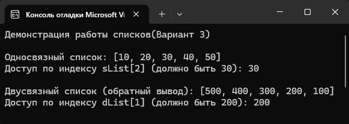

# Лабораторная работа №4: Односвязный и двусвязный списки

**Студент:** Аджамян Рудик Агаронович  
**Группа:** ПИЖ-б-о-25-2(1)  
**Дисциплина:** Алгоритмы и структура данных  
**Вариант:** 3 (Продвинутый уровень)  
**Тема индивидуального задания:** Реализация обоих списков и оператора `[]` для доступа по индексу.

**Проверила:** Белик Ангелина Игоревна  

## 1. Цель работы  
1. Реализовать шаблонный класс односвязного списка (`SinglyLinkedList`) с базовыми операциями.
2. Реализовать шаблонный класс двусвязного списка (`DoublyLinkedList`) с базовыми операциями.
3. Освоить операции вставки, удаления и обхода элементов в списках.
4. Сравнить особенности использования односвязного и двусвязного списков.
5. Научиться правильно управлять памятью при работе со списками.
6. Реализовать доступ к элементам по индексу через перегрузку оператора `[]`.

## 2. Теоретическая часть
**Связный список** — это структура данных, в которой элементы (узлы) хранятся в памяти не непрерывно. Каждый узел содержит данные и указатель на следующий узел (для односвязного) и/или на предыдущий (для двусвязного).

**Узел (Node)** — базовая единица списка. 
**Head** — указатель на первый элемент списка. 
**Tail** — указатель на последний элемент списка (позволяет добавлять элементы в конец за O(1)).

## 3. Постановка задачи
Согласно варианту 3 (продвинутый уровень), необходимо:
1. Реализовать класс `SinglyLinkedList` (односвязный список).
2. Реализовать класс `DoublyLinkedList` (двусвязный список).
3. Реализовать оператор `[]` для обоих списков (с проверкой выхода за границы).
4. Обеспечить корректное управление памятью (деструкторы и очистка).

## 4. Листинг программы

```cpp
#include <iostream>
#include <stdexcept>

using namespace std;

template <typename T>
class SinglyLinkedList {
private:
    struct Node {
        T data;
        Node* next;
        Node(const T& value) : data(value), next(nullptr) {}
    };

    Node* head;
    Node* tail;
    int count;

public:
    SinglyLinkedList() : head(nullptr), tail(nullptr), count(0) {}
    ~SinglyLinkedList() { clear(); }

    void push_back(const T& value) {
        Node* newNode = new Node(value);
        if (head == nullptr) {
            head = tail = newNode;
        }
        else {
            tail->next = newNode;
            tail = newNode;
        }
        count++;
    }

    T& operator[](int index) {
        if (index < 0 || index >= count) {
            throw out_of_range("Index out of range");
        }
        Node* current = head;
        for (int i = 0; i < index; i++) {
            current = current->next;
        }
        return current->data;
    }

    void print() const {
        Node* current = head;
        cout << "[";
        while (current != nullptr) {
            cout << current->data;
            if (current->next != nullptr) cout << ", ";
            current = current->next;
        }
        cout << "]" << endl;
    }

    void clear() {
        while (head != nullptr) {
            Node* temp = head;
            head = head->next;
            delete temp;
        }
        tail = nullptr;
        count = 0;
    }

    int size() const { return count; }
    bool empty() const { return head == nullptr; }
};

template <typename T>
class DoublyLinkedList {
private:
    struct Node {
        T data;
        Node* prev;
        Node* next;
        Node(const T& value) : data(value), prev(nullptr), next(nullptr) {}
    };

    Node* head;
    Node* tail;
    int count;

public:
    DoublyLinkedList() : head(nullptr), tail(nullptr), count(0) {}
    ~DoublyLinkedList() { clear(); }

    void push_back(const T& value) {
        Node* newNode = new Node(value);
        if (tail == nullptr) {
            head = tail = newNode;
        }
        else {
            tail->next = newNode;
            newNode->prev = tail;
            tail = newNode;
        }
        count++;
    }

    T& operator[](int index) {
        if (index < 0 || index >= count) {
            throw out_of_range("Index out of range");
        }
        Node* current = head;
        for (int i = 0; i < index; i++) {
            current = current->next;
        }
        return current->data;
    }

    void printReverse() const {
        Node* current = tail;
        cout << "[";
        while (current != nullptr) {
            cout << current->data;
            if (current->prev != nullptr) cout << ", ";
            current = current->prev;
        }
        cout << "]" << endl;
    }

    void clear() {
        while (head != nullptr) {
            Node* temp = head;
            head = head->next;
            delete temp;
        }
        tail = nullptr;
        count = 0;
    }

    int size() const { return count; }
    bool empty() const { return head == nullptr; }
};

int main() {
    setlocale(LC_ALL, "ru");

    cout << "Демонстрация работы списков(Вариант 3)" << endl;

    SinglyLinkedList<int> sList;
    for (int i = 1; i <= 5; i++) sList.push_back(i * 10);

    cout << "\nОдносвязный список: ";
    sList.print();
    cout << "Доступ по индексу sList[2] (должно быть 30): " << sList[2] << endl;

    DoublyLinkedList<int> dList;
    for (int i = 1; i <= 5; i++) dList.push_back(i * 100);

    cout << "\nДвусвязный список (обратный вывод): ";
    dList.printReverse();
    cout << "Доступ по индексу dList[1] (должно быть 200): " << dList[1] << endl;

    return 0;
}
```
## 5. Результаты работы программы

   
**Рисунок 1 — `img-1.png`.** Демонстрация работы односвязного и двусвязного списков, а также оператора `[]`.

## 6. Анализ сложности операций
- **`push_back` (с указателем tail)**: **O(1)**. Добавление в конец происходит за константное время.
- **`operator[]` (доступ по индексу)**: **O(n)**. Чтобы найти элемент по индексу, нужно пройти от головы списка до нужного узла.
- **`print` (обход)**: **O(n)**. Требуется пройти по всем элементам списка.
- **`clear` (очистка)**: **O(n)**. Удаление каждого узла занимает линейное время.

## 7. Ответы на контрольные вопросы

### 1. Чем связный список отличается от динамического массива?
В динамическом массиве (векторе) элементы хранятся в памяти непрерывно, что обеспечивает быстрый доступ по индексу O(1). В связном списке элементы разбросаны по памяти и связаны указателями, поэтому доступ по индексу требует O(n) времени, но вставка и удаление элементов в начале или середине выполняются быстрее, так как не требуют сдвига всех элементов.

### 2. Какие операции в односвязном списке выполняются за O(1)?
Вставка в начало (`push_front`), вставка в конец при наличии указателя `tail` (`push_back`), удаление из начала (`pop_front`).

### 3. Почему удаление из конца односвязного списка требует O(n) времени?
Потому что в односвязном списке есть указатели только на следующий элемент. Чтобы удалить последний элемент, нужно изменить указатель `next` у предпоследнего элемента. Для этого приходится проходить весь список с начала до предпоследнего узла, что занимает O(n) времени.

### 4. Какие преимущества даёт хранение указателя tail в односвязном списке?
Указатель `tail` позволяет добавлять элементы в конец списка за O(1), так как не нужно искать последний элемент обходом всего списка.

### 5. Чем двусвязный список отличается от односвязного?
В двусвязном списке каждый узел содержит два указателя: на следующий элемент (`next`) и на предыдущий (`prev`). Это позволяет обходить список в обоих направлениях.

### 6. Какие операции в двусвязном списке выполняются быстрее, чем в односвязном?
Удаление с конца (`pop_back`) выполняется за O(1), так как благодаря указателю `prev` мы сразу имеем доступ к предпоследнему элементу. В односвязном списке это заняло бы O(n).

### 7. Что такое «голова» (head) и «хвост» (tail) списка?
`head` — это указатель на первый узел списка. `tail` — указатель на последний узел списка.

### 8. Как удалить узел из середины односвязного списка?
Нужно найти узел, предшествующий удаляемому, и перенаправить его указатель `next` через удаляемый узел на следующий. После чего освободить память удаляемого узла.

### 9. Как удалить узел из середины двусвязного списка? Почему это проще?
Нужно взять удаляемый узел и перенаправить указатели `next->prev = prev` и `prev->next = next`. Это проще, потому что у нас есть прямой доступ к предыдущему узлу, и не нужно искать его обходом с начала.

### 10. Что произойдёт, если забыть обновить tail при удалении?
Если удаляется последний элемент, а указатель `tail` не обновить, он будет указывать на уже удалённую (освобождённую) память. Любая попытка добавить новый элемент в конец приведёт к ошибке сегментации (крашу программы).

### 11. Как реализовать реверс односвязного списка?
Нужно пройти по списку, сохраняя текущий, предыдущий и следующий узлы. На каждом шаге менять указатель `next` текущего узла на предыдущий. В конце обновить `head` и `tail`.

### 12. Как обнаружить цикл в связном списке?
С помощью «алгоритма черепахи и зайца» (алгоритм Флойда). Запускаются два указателя: один движется на один шаг, второй — на два. Если они встретятся, значит в списке есть цикл.

### 13. В каких случаях стоит использовать список вместо массива?
Когда требуется часто вставлять или удалять элементы в начале или середине коллекции, а доступ по индексу не критичен. Также когда заранее неизвестно точное количество элементов.

### 14. Какая дополнительная память требуется для каждого узла списка?
Для односвязного: данные + 1 указатель (на следующий). Для двусвязного: данные + 2 указателя (на следующий и предыдущий).

### 15. Почему доступ по индексу в списке имеет сложность O(n)?
Потому что элементы списка не хранятся в памяти последовательно. У нас нет формулы для вычисления адреса элемента по индексу (как в массиве). Чтобы добраться до `i`-го элемента, нужно последовательно перейти от `head` по указателям `next` ровно `i` раз.

## 8. Выводы
В ходе работы были реализованы шаблонные классы односвязного и двусвязного списков. Освоено управление указателями и ручное выделение/освобождение памяти для узлов. Реализован доступ по индексу через оператор `[]`. Проведен анализ сложности операций: двусвязный список позволяет быстрее удалять элементы с конца, но требует больше памяти.

## 9. Ссылка на Git-репозиторий
**Репозиторий GitHub:** [вставить ссылку на репозиторий с исходным кодом]