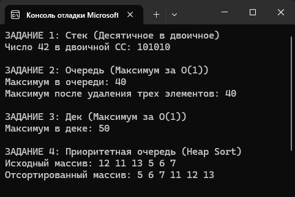

# Лабораторная работа №5: Стек, очередь, дек, приоритетная очередь

**Студент:** Аджамян Рудик Агаронович  
**Группа:** ПИЖ-б-о-25-2(1)  
**Дисциплина:** Алгоритмы и структура данных  
**Вариант:** 3  
**Тема индивидуального задания:** Решение 4 задач на базовые структуры данных.

**Проверила:** Белик Ангелина Игоревна  

## 1. Цель работы  
1. Реализовать основные линейные структуры данных: стек, очередь, дек и приоритетную очередь.
2. Освоить принципы LIFO (стек) и FIFO (очередь).
3. Научиться реализовывать эти структуры на основе динамического массива.
4. Изучить применение стека для решения задач.
5. Реализовать приоритетную очередь на основе кучи (heap).

## 2. Теоретическая часть
**Стек** — структура данных, работающая по принципу LIFO («последним пришёл — первым ушёл»).
**Очередь** — структура данных, работающая по принципу FIFO («первым пришёл — первым ушёл»).
**Дек** — двусторонняя очередь, позволяющая добавлять и удалять элементы с обоих концов.
**Приоритетная очередь** — очередь, в которой элементы извлекаются в порядке убывания (или возрастания) приоритета. Реализуется на основе двоичной кучи (heap).

## 3. Постановка задачи (Вариант 3)
1. **Стек:** Перевести число из десятичной системы в двоичную.
2. **Очередь:** Найти максимальный элемент в очереди за O(1).
3. **Дек:** Найти максимальный элемент в деке за O(1).
4. **Приоритетная очередь:** Сортировка с помощью приоритетной очереди (Heap Sort).

## 4. Листинг программы

```cpp
#include <iostream>
#include <stdexcept>
#include <string>
#include <deque>

using namespace std;

template <typename T>
class Stack {
private:
    T* data;
    int topIndex;
    int capacity;
    void resize() {
        int newCapacity = capacity * 2;
        T* newData = new T[newCapacity];
        for (int i = 0; i <= topIndex; i++) newData[i] = data[i];
        delete[] data;
        data = newData;
        capacity = newCapacity;
    }
public:
    Stack(int initialCapacity = 10) : capacity(initialCapacity), topIndex(-1) {
        data = new T[capacity];
    }
    ~Stack() { delete[] data; }
    void push(const T& value) {
        if (topIndex >= capacity - 1) resize();
        data[++topIndex] = value;
    }
    T pop() {
        if (isEmpty()) throw underflow_error("Stack is empty");
        return data[topIndex--];
    }
    T top() const {
        if (isEmpty()) throw underflow_error("Stack is empty");
        return data[topIndex];
    }
    bool isEmpty() const { return topIndex == -1; }
};

string decimalToBinary(int num) {
    if (num == 0) return "0";
    Stack<int> st;
    while (num > 0) {
        st.push(num % 2);
        num /= 2;
    }
    string result = "";
    while (!st.isEmpty()) {
        result += to_string(st.pop());
    }
    return result;
}

template <typename T>
class MaxQueue {
private:
    T* data;
    int frontIndex;
    int rearIndex;
    int capacity;
    int count;
    deque<T> maxDeque;
    void resize() {
        int newCapacity = capacity * 2;
        T* newData = new T[newCapacity];
        for (int i = 0; i < count; i++) newData[i] = data[(frontIndex + i) % capacity];
        delete[] data;
        data = newData;
        frontIndex = 0;
        rearIndex = count;
        capacity = newCapacity;
    }
public:
    MaxQueue(int initialCapacity = 10) : capacity(initialCapacity), frontIndex(0), rearIndex(0), count(0) {
        data = new T[capacity];
    }
    ~MaxQueue() { delete[] data; }
    void enqueue(const T& value) {
        if (count >= capacity) resize();
        data[rearIndex] = value;
        rearIndex = (rearIndex + 1) % capacity;
        while (!maxDeque.empty() && maxDeque.back() < value) maxDeque.pop_back();
        maxDeque.push_back(value);
        count++;
    }
    T dequeue() {
        if (isEmpty()) throw underflow_error("Queue is empty");
        T value = data[frontIndex];
        if (value == maxDeque.front()) maxDeque.pop_front();
        frontIndex = (frontIndex + 1) % capacity;
        count--;
        return value;
    }
    T getMax() const {
        if (isEmpty()) throw underflow_error("Queue is empty");
        return maxDeque.front();
    }
    bool isEmpty() const { return count == 0; }
};

template <typename T>
class MaxDeque {
private:
    T* data;
    int frontIndex;
    int rearIndex;
    int capacity;
    int count;
    deque<T> maxDeque;
    void resize() {
        int newCapacity = capacity * 2;
        T* newData = new T[newCapacity];
        for (int i = 0; i < count; i++) newData[i] = data[(frontIndex + i) % capacity];
        delete[] data;
        data = newData;
        frontIndex = 0;
        rearIndex = count;
        capacity = newCapacity;
    }
public:
    MaxDeque(int initialCapacity = 10) : capacity(initialCapacity), frontIndex(0), rearIndex(0), count(0) {
        data = new T[capacity];
    }
    ~MaxDeque() { delete[] data; }
    void push_back(const T& value) {
        if (count >= capacity) resize();
        data[rearIndex] = value;
        rearIndex = (rearIndex + 1) % capacity;
        while (!maxDeque.empty() && maxDeque.back() < value) maxDeque.pop_back();
        maxDeque.push_back(value);
        count++;
    }
    void push_front(const T& value) {
        if (count >= capacity) resize();
        frontIndex = (frontIndex - 1 + capacity) % capacity;
        data[frontIndex] = value;
        while (!maxDeque.empty() && maxDeque.front() < value) maxDeque.pop_front();
        maxDeque.push_front(value);
        count++;
    }
    T getMax() const {
        if (isEmpty()) throw underflow_error("Deque is empty");
        return maxDeque.front();
    }
    bool isEmpty() const { return count == 0; }
};

template <typename T>
class PriorityQueue {
private:
    T* heap;
    int count;
    int capacity;
    void resize() {
        int newCapacity = capacity * 2;
        T* newHeap = new T[newCapacity];
        for (int i = 0; i < count; i++) newHeap[i] = heap[i];
        delete[] heap;
        heap = newHeap;
        capacity = newCapacity;
    }
    void heapifyUp(int index) {
        while (index > 0) {
            int parent = (index - 1) / 2;
            if (heap[index] > heap[parent]) {
                swap(heap[index], heap[parent]);
                index = parent;
            }
            else break;
        }
    }
    void heapifyDown(int index) {
        while (true) {
            int left = 2 * index + 1;
            int right = 2 * index + 2;
            int largest = index;
            if (left < count && heap[left] > heap[largest]) largest = left;
            if (right < count && heap[right] > heap[largest]) largest = right;
            if (largest == index) break;
            swap(heap[index], heap[largest]);
            index = largest;
        }
    }
public:
    PriorityQueue(int initialCapacity = 10) : capacity(initialCapacity), count(0) {
        heap = new T[capacity];
    }
    ~PriorityQueue() { delete[] heap; }
    void push(const T& value) {
        if (count >= capacity) resize();
        heap[count] = value;
        heapifyUp(count);
        count++;
    }
    T pop() {
        if (isEmpty()) throw underflow_error("PriorityQueue is empty");
        T maxValue = heap[0];
        heap[0] = heap[count - 1];
        count--;
        heapifyDown(0);
        return maxValue;
    }
    bool isEmpty() const { return count == 0; }
};

void heapSort(int arr[], int n) {
    PriorityQueue<int> pq(n);
    for (int i = 0; i < n; i++) pq.push(arr[i]);
    for (int i = n - 1; i >= 0; i--) arr[i] = pq.pop();
}

int main() {
    setlocale(LC_ALL, "ru");

    cout << "ЗАДАНИЕ 1: Стек (Десятичное в двоичное)" << endl;
    int num = 42;
    cout << "Число " << num << " в двоичной СС: " << decimalToBinary(num) << endl << endl;

    cout << "ЗАДАНИЕ 2: Очередь (Максимум за O(1))" << endl;
    MaxQueue<int> q;
    q.enqueue(10); q.enqueue(25); q.enqueue(5); q.enqueue(40);
    cout << "Максимум в очереди: " << q.getMax() << endl;
    q.dequeue(); q.dequeue(); q.dequeue();
    cout << "Максимум после удаления трех элементов: " << q.getMax() << endl << endl;

    cout << "ЗАДАНИЕ 3: Дек (Максимум за O(1))" << endl;
    MaxDeque<int> dq;
    dq.push_back(15); dq.push_back(8); dq.push_front(50); dq.push_back(20);
    cout << "Максимум в деке: " << dq.getMax() << endl << endl;

    cout << "ЗАДАНИЕ 4: Приоритетная очередь (Heap Sort)" << endl;
    int arr[] = { 12, 11, 13, 5, 6, 7 };
    int n = sizeof(arr) / sizeof(arr[0]);
    cout << "Исходный массив: ";
    for (int i = 0; i < n; i++) cout << arr[i] << " ";
    cout << endl;

    heapSort(arr, n);
    cout << "Отсортированный массив: ";
    for (int i = 0; i < n; i++) cout << arr[i] << " ";
    cout << endl;

    return 0;
}#include <iostream>
#include <stdexcept>
#include <string>
#include <deque>

using namespace std;

template <typename T>
class Stack {
private:
    T* data;
    int topIndex;
    int capacity;
    void resize() {
        int newCapacity = capacity * 2;
        T* newData = new T[newCapacity];
        for (int i = 0; i <= topIndex; i++) newData[i] = data[i];
        delete[] data;
        data = newData;
        capacity = newCapacity;
    }
public:
    Stack(int initialCapacity = 10) : capacity(initialCapacity), topIndex(-1) {
        data = new T[capacity];
    }
    ~Stack() { delete[] data; }
    void push(const T& value) {
        if (topIndex >= capacity - 1) resize();
        data[++topIndex] = value;
    }
    T pop() {
        if (isEmpty()) throw underflow_error("Stack is empty");
        return data[topIndex--];
    }
    T top() const {
        if (isEmpty()) throw underflow_error("Stack is empty");
        return data[topIndex];
    }
    bool isEmpty() const { return topIndex == -1; }
};

string decimalToBinary(int num) {
    if (num == 0) return "0";
    Stack<int> st;
    while (num > 0) {
        st.push(num % 2);
        num /= 2;
    }
    string result = "";
    while (!st.isEmpty()) {
        result += to_string(st.pop());
    }
    return result;
}

template <typename T>
class MaxQueue {
private:
    T* data;
    int frontIndex;
    int rearIndex;
    int capacity;
    int count;
    deque<T> maxDeque;
    void resize() {
        int newCapacity = capacity * 2;
        T* newData = new T[newCapacity];
        for (int i = 0; i < count; i++) newData[i] = data[(frontIndex + i) % capacity];
        delete[] data;
        data = newData;
        frontIndex = 0;
        rearIndex = count;
        capacity = newCapacity;
    }
public:
    MaxQueue(int initialCapacity = 10) : capacity(initialCapacity), frontIndex(0), rearIndex(0), count(0) {
        data = new T[capacity];
    }
    ~MaxQueue() { delete[] data; }
    void enqueue(const T& value) {
        if (count >= capacity) resize();
        data[rearIndex] = value;
        rearIndex = (rearIndex + 1) % capacity;
        while (!maxDeque.empty() && maxDeque.back() < value) maxDeque.pop_back();
        maxDeque.push_back(value);
        count++;
    }
    T dequeue() {
        if (isEmpty()) throw underflow_error("Queue is empty");
        T value = data[frontIndex];
        if (value == maxDeque.front()) maxDeque.pop_front();
        frontIndex = (frontIndex + 1) % capacity;
        count--;
        return value;
    }
    T getMax() const {
        if (isEmpty()) throw underflow_error("Queue is empty");
        return maxDeque.front();
    }
    bool isEmpty() const { return count == 0; }
};

template <typename T>
class MaxDeque {
private:
    T* data;
    int frontIndex;
    int rearIndex;
    int capacity;
    int count;
    deque<T> maxDeque;
    void resize() {
        int newCapacity = capacity * 2;
        T* newData = new T[newCapacity];
        for (int i = 0; i < count; i++) newData[i] = data[(frontIndex + i) % capacity];
        delete[] data;
        data = newData;
        frontIndex = 0;
        rearIndex = count;
        capacity = newCapacity;
    }
public:
    MaxDeque(int initialCapacity = 10) : capacity(initialCapacity), frontIndex(0), rearIndex(0), count(0) {
        data = new T[capacity];
    }
    ~MaxDeque() { delete[] data; }
    void push_back(const T& value) {
        if (count >= capacity) resize();
        data[rearIndex] = value;
        rearIndex = (rearIndex + 1) % capacity;
        while (!maxDeque.empty() && maxDeque.back() < value) maxDeque.pop_back();
        maxDeque.push_back(value);
        count++;
    }
    void push_front(const T& value) {
        if (count >= capacity) resize();
        frontIndex = (frontIndex - 1 + capacity) % capacity;
        data[frontIndex] = value;
        while (!maxDeque.empty() && maxDeque.front() < value) maxDeque.pop_front();
        maxDeque.push_front(value);
        count++;
    }
    T getMax() const {
        if (isEmpty()) throw underflow_error("Deque is empty");
        return maxDeque.front();
    }
    bool isEmpty() const { return count == 0; }
};

template <typename T>
class PriorityQueue {
private:
    T* heap;
    int count;
    int capacity;
    void resize() {
        int newCapacity = capacity * 2;
        T* newHeap = new T[newCapacity];
        for (int i = 0; i < count; i++) newHeap[i] = heap[i];
        delete[] heap;
        heap = newHeap;
        capacity = newCapacity;
    }
    void heapifyUp(int index) {
        while (index > 0) {
            int parent = (index - 1) / 2;
            if (heap[index] > heap[parent]) {
                swap(heap[index], heap[parent]);
                index = parent;
            }
            else break;
        }
    }
    void heapifyDown(int index) {
        while (true) {
            int left = 2 * index + 1;
            int right = 2 * index + 2;
            int largest = index;
            if (left < count && heap[left] > heap[largest]) largest = left;
            if (right < count && heap[right] > heap[largest]) largest = right;
            if (largest == index) break;
            swap(heap[index], heap[largest]);
            index = largest;
        }
    }
public:
    PriorityQueue(int initialCapacity = 10) : capacity(initialCapacity), count(0) {
        heap = new T[capacity];
    }
    ~PriorityQueue() { delete[] heap; }
    void push(const T& value) {
        if (count >= capacity) resize();
        heap[count] = value;
        heapifyUp(count);
        count++;
    }
    T pop() {
        if (isEmpty()) throw underflow_error("PriorityQueue is empty");
        T maxValue = heap[0];
        heap[0] = heap[count - 1];
        count--;
        heapifyDown(0);
        return maxValue;
    }
    bool isEmpty() const { return count == 0; }
};

void heapSort(int arr[], int n) {
    PriorityQueue<int> pq(n);
    for (int i = 0; i < n; i++) pq.push(arr[i]);
    for (int i = n - 1; i >= 0; i--) arr[i] = pq.pop();
}

int main() {
    setlocale(LC_ALL, "ru");

    cout << "ЗАДАНИЕ 1: Стек (Десятичное в двоичное)" << endl;
    int num = 42;
    cout << "Число " << num << " в двоичной СС: " << decimalToBinary(num) << endl << endl;

    cout << "ЗАДАНИЕ 2: Очередь (Максимум за O(1))" << endl;
    MaxQueue<int> q;
    q.enqueue(10); q.enqueue(25); q.enqueue(5); q.enqueue(40);
    cout << "Максимум в очереди: " << q.getMax() << endl;
    q.dequeue(); q.dequeue(); q.dequeue();
    cout << "Максимум после удаления трех элементов: " << q.getMax() << endl << endl;

    cout << "ЗАДАНИЕ 3: Дек (Максимум за O(1))" << endl;
    MaxDeque<int> dq;
    dq.push_back(15); dq.push_back(8); dq.push_front(50); dq.push_back(20);
    cout << "Максимум в деке: " << dq.getMax() << endl << endl;

    cout << "ЗАДАНИЕ 4: Приоритетная очередь (Heap Sort)" << endl;
    int arr[] = { 12, 11, 13, 5, 6, 7 };
    int n = sizeof(arr) / sizeof(arr[0]);
    cout << "Исходный массив: ";
    for (int i = 0; i < n; i++) cout << arr[i] << " ";
    cout << endl;

    heapSort(arr, n);
    cout << "Отсортированный массив: ";
    for (int i = 0; i < n; i++) cout << arr[i] << " ";
    cout << endl;

    return 0;
}#include <iostream>
#include <stdexcept>
#include <string>
#include <deque>

using namespace std;

template <typename T>
class Stack {
private:
    T* data;
    int topIndex;
    int capacity;
    void resize() {
        int newCapacity = capacity * 2;
        T* newData = new T[newCapacity];
        for (int i = 0; i <= topIndex; i++) newData[i] = data[i];
        delete[] data;
        data = newData;
        capacity = newCapacity;
    }
public:
    Stack(int initialCapacity = 10) : capacity(initialCapacity), topIndex(-1) {
        data = new T[capacity];
    }
    ~Stack() { delete[] data; }
    void push(const T& value) {
        if (topIndex >= capacity - 1) resize();
        data[++topIndex] = value;
    }
    T pop() {
        if (isEmpty()) throw underflow_error("Stack is empty");
        return data[topIndex--];
    }
    T top() const {
        if (isEmpty()) throw underflow_error("Stack is empty");
        return data[topIndex];
    }
    bool isEmpty() const { return topIndex == -1; }
};

string decimalToBinary(int num) {
    if (num == 0) return "0";
    Stack<int> st;
    while (num > 0) {
        st.push(num % 2);
        num /= 2;
    }
    string result = "";
    while (!st.isEmpty()) {
        result += to_string(st.pop());
    }
    return result;
}

template <typename T>
class MaxQueue {
private:
    T* data;
    int frontIndex;
    int rearIndex;
    int capacity;
    int count;
    deque<T> maxDeque;
    void resize() {
        int newCapacity = capacity * 2;
        T* newData = new T[newCapacity];
        for (int i = 0; i < count; i++) newData[i] = data[(frontIndex + i) % capacity];
        delete[] data;
        data = newData;
        frontIndex = 0;
        rearIndex = count;
        capacity = newCapacity;
    }
public:
    MaxQueue(int initialCapacity = 10) : capacity(initialCapacity), frontIndex(0), rearIndex(0), count(0) {
        data = new T[capacity];
    }
    ~MaxQueue() { delete[] data; }
    void enqueue(const T& value) {
        if (count >= capacity) resize();
        data[rearIndex] = value;
        rearIndex = (rearIndex + 1) % capacity;
        while (!maxDeque.empty() && maxDeque.back() < value) maxDeque.pop_back();
        maxDeque.push_back(value);
        count++;
    }
    T dequeue() {
        if (isEmpty()) throw underflow_error("Queue is empty");
        T value = data[frontIndex];
        if (value == maxDeque.front()) maxDeque.pop_front();
        frontIndex = (frontIndex + 1) % capacity;
        count--;
        return value;
    }
    T getMax() const {
        if (isEmpty()) throw underflow_error("Queue is empty");
        return maxDeque.front();
    }
    bool isEmpty() const { return count == 0; }
};

template <typename T>
class MaxDeque {
private:
    T* data;
    int frontIndex;
    int rearIndex;
    int capacity;
    int count;
    deque<T> maxDeque;
    void resize() {
        int newCapacity = capacity * 2;
        T* newData = new T[newCapacity];
        for (int i = 0; i < count; i++) newData[i] = data[(frontIndex + i) % capacity];
        delete[] data;
        data = newData;
        frontIndex = 0;
        rearIndex = count;
        capacity = newCapacity;
    }
public:
    MaxDeque(int initialCapacity = 10) : capacity(initialCapacity), frontIndex(0), rearIndex(0), count(0) {
        data = new T[capacity];
    }
    ~MaxDeque() { delete[] data; }
    void push_back(const T& value) {
        if (count >= capacity) resize();
        data[rearIndex] = value;
        rearIndex = (rearIndex + 1) % capacity;
        while (!maxDeque.empty() && maxDeque.back() < value) maxDeque.pop_back();
        maxDeque.push_back(value);
        count++;
    }
    void push_front(const T& value) {
        if (count >= capacity) resize();
        frontIndex = (frontIndex - 1 + capacity) % capacity;
        data[frontIndex] = value;
        while (!maxDeque.empty() && maxDeque.front() < value) maxDeque.pop_front();
        maxDeque.push_front(value);
        count++;
    }
    T getMax() const {
        if (isEmpty()) throw underflow_error("Deque is empty");
        return maxDeque.front();
    }
    bool isEmpty() const { return count == 0; }
};

template <typename T>
class PriorityQueue {
private:
    T* heap;
    int count;
    int capacity;
    void resize() {
        int newCapacity = capacity * 2;
        T* newHeap = new T[newCapacity];
        for (int i = 0; i < count; i++) newHeap[i] = heap[i];
        delete[] heap;
        heap = newHeap;
        capacity = newCapacity;
    }
    void heapifyUp(int index) {
        while (index > 0) {
            int parent = (index - 1) / 2;
            if (heap[index] > heap[parent]) {
                swap(heap[index], heap[parent]);
                index = parent;
            }
            else break;
        }
    }
    void heapifyDown(int index) {
        while (true) {
            int left = 2 * index + 1;
            int right = 2 * index + 2;
            int largest = index;
            if (left < count && heap[left] > heap[largest]) largest = left;
            if (right < count && heap[right] > heap[largest]) largest = right;
            if (largest == index) break;
            swap(heap[index], heap[largest]);
            index = largest;
        }
    }
public:
    PriorityQueue(int initialCapacity = 10) : capacity(initialCapacity), count(0) {
        heap = new T[capacity];
    }
    ~PriorityQueue() { delete[] heap; }
    void push(const T& value) {
        if (count >= capacity) resize();
        heap[count] = value;
        heapifyUp(count);
        count++;
    }
    T pop() {
        if (isEmpty()) throw underflow_error("PriorityQueue is empty");
        T maxValue = heap[0];
        heap[0] = heap[count - 1];
        count--;
        heapifyDown(0);
        return maxValue;
    }
    bool isEmpty() const { return count == 0; }
};

void heapSort(int arr[], int n) {
    PriorityQueue<int> pq(n);
    for (int i = 0; i < n; i++) pq.push(arr[i]);
    for (int i = n - 1; i >= 0; i--) arr[i] = pq.pop();
}

int main() {
    setlocale(LC_ALL, "ru");

    cout << "ЗАДАНИЕ 1: Стек (Десятичное в двоичное)" << endl;
    int num = 42;
    cout << "Число " << num << " в двоичной СС: " << decimalToBinary(num) << endl << endl;

    cout << "ЗАДАНИЕ 2: Очередь (Максимум за O(1))" << endl;
    MaxQueue<int> q;
    q.enqueue(10); q.enqueue(25); q.enqueue(5); q.enqueue(40);
    cout << "Максимум в очереди: " << q.getMax() << endl;
    q.dequeue(); q.dequeue(); q.dequeue();
    cout << "Максимум после удаления трех элементов: " << q.getMax() << endl << endl;

    cout << "ЗАДАНИЕ 3: Дек (Максимум за O(1))" << endl;
    MaxDeque<int> dq;
    dq.push_back(15); dq.push_back(8); dq.push_front(50); dq.push_back(20);
    cout << "Максимум в деке: " << dq.getMax() << endl << endl;

    cout << "ЗАДАНИЕ 4: Приоритетная очередь (Heap Sort)" << endl;
    int arr[] = { 12, 11, 13, 5, 6, 7 };
    int n = sizeof(arr) / sizeof(arr[0]);
    cout << "Исходный массив: ";
    for (int i = 0; i < n; i++) cout << arr[i] << " ";
    cout << endl;

    heapSort(arr, n);
    cout << "Отсортированный массив: ";
    for (int i = 0; i < n; i++) cout << arr[i] << " ";
    cout << endl;

    return 0;
}
```

## 5. Результат работы программы

   
**Рисунок 1 — `img-1.png`.** Демонстрация работы всех 4 заданий.

## 6. Анализ сложности операций
- **Стек (push, pop, top)**: O(1), так как работа происходит только с верхним элементом.
- **Очередь (enqueue, dequeue)**: O(1). Поиск максимума в моей реализации также O(1), так как используется вспомогательный дек.
- **Дек (push_front, push_back, pop_front, pop_back)**: O(1). Поиск максимума O(1).
- **Приоритетная очередь (push, pop)**: O(log n), так как требуется просеивание элемента по куче (heapify). Верхний элемент `top()` — O(1).
- **Heap Sort**: O(n log n), так как мы n раз добавляем элементы в кучу (log n) и n раз извлекаем.

## 7. Выводы
В ходе работы были реализованы стек, очередь, дек и приоритетная очередь. Решены задачи на применение этих структур: перевод в двоичную систему, поиск максимума за O(1), сортировка кучей. Освоены принципы работы LIFO и FIFO, а также реализация кучи для приоритетной очереди.


## 8. Ответы на контрольные вопросы

### 1. В чём заключается принцип работы стека (LIFO)?
LIFO (Last In, First Out) — последний добавленный элемент извлекается первым. Как стопка тарелок: чтобы взять нижнюю, нужно сначала убрать верхние.

### 2. В чём заключается принцип работы очереди (FIFO)?
FIFO (First In, First Out) — первый добавленный элемент извлекается первым. Как очередь в магазине.

### 3. Чем дек отличается от обычной очереди?
Дек (Double-Ended Queue) позволяет добавлять и удалять элементы с обоих концов (и в начало, и в конец), а обычная очередь — только с одного (добавление в конец, удаление из начала).

### 4. Что такое приоритетная очередь? Где она применяется?
Это очередь, где элементы извлекаются в зависимости от их приоритета. Применяется в алгоритмах Дейкстры, планировщиках задач ОС, сжатии Хаффмана.

### 5. Как реализовать стек на основе динамического массива?
Нужно хранить массив и индекс верхнего элемента (`topIndex`). При добавлении увеличивать индекс, при удалении — уменьшать. Если места нет — расширять массив.

### 6. Как реализовать очередь на основе кольцевого буфера?
Нужно использовать массив, указатель на начало (`front`) и указатель на конец (`rear`). При добавлении `rear = (rear + 1) % capacity`. При удалении `front = (front + 1) % capacity`. Это позволяет избежать сдвига элементов.

### 7. Почему приоритетную очередь обычно реализуют на куче?
Куча (heap) позволяет выполнять вставку и извлечение максимального элемента за O(log n), а получение максимума — за O(1). Это оптимальный баланс для данной структуры.

### 8. Какова сложность операций push и pop в стеке?
**O(1)**. Не зависит от количества элементов.

### 9. Какова сложность операций enqueue и dequeue в очереди?
**O(1)** (при использовании кольцевого буфера или связного списка).

### 10. Какова сложность операций в приоритетной очереди? Почему?
**O(log n)** для вставки и извлечения, потому что после изменения структуры кучи нужно восстанавливать её свойства (просеивать элемент вверх или вниз), а высота кучи равна log n. Получение максимума — O(1).

### 11. Как проверить правильность расстановки скобок с помощью стека?
Нужно идти по строке. Открывающую скобку класть в стек. При закрывающей — проверять, совпадает ли она с верхней в стеке. Если в конце стек пуст — скобки расставлены верно.

### 12. Как реализовать очередь на двух стеках? Какова сложность?
Есть стек для добавления (`in`) и стек для извлечения (`out`). При добавлении кладем в `in`. При извлечении, если `out` пуст, перекладываем все элементы из `in` в `out`, затем извлекаем из `out`. Амортизированная сложность — **O(1)**.

### 13. Как реализовать дек на основе двусвязного списка?
Каждый узел содержит указатели на следующий и предыдущий. Добавление/удаление с обоих концов выполняется за O(1) путем перестановки указателей `head` и `tail`.

### 14. Как реализовать дек на основе кольцевого буфера?
Так же, как и очередь, но нужно добавить операции `push_front` и `pop_back`. При `push_front` индекс `front` уменьшается на 1 (с учетом закольцовывания). При `pop_back` уменьшается индекс `rear`.

### 15. Как реализовать стек с поддержкой получения минимума за О(1)?
Нужно использовать два стека: основной и вспомогательный. В основной кладем все элементы, а во вспомогательный — только текущий минимум. При удалении элемента из основного, если он равен минимуму, удаляем и из вспомогательного. Тогда `top()` вспомогательного стека всегда будет минимумом.