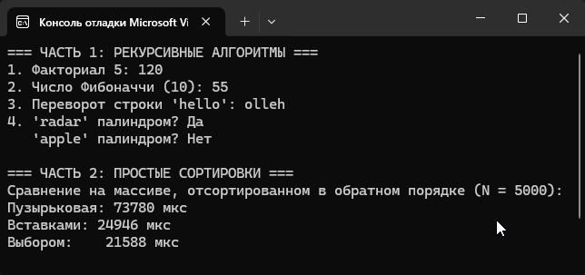

# Лабораторная работа №6: Рекурсивные алгоритмы. Простые сортировки

**Студент:** Аджамян Рудик Агаронович  
**Группа:** ПИЖ-б-о-25-2(1)  
**Дисциплина:** Алгоритмы и структура данных  
**Вариант:** 3  
**Тема индивидуального задания:** Рекурсивные алгоритмы и простые сортировки.

**Проверила:** Белик Ангелина Игоревна  

## 1. Цель работы  
1. Освоить принципы рекурсии: прямой и косвенной, базовый случай и шаг рекурсии.
2. Научиться применять рекурсию для решения практических задач.
3. Реализовать и сравнить простые алгоритмы сортировки: пузырьковую, вставками, выбором.
4. Проанализировать сложность рекурсивных алгоритмов и простых сортировок.
5. Сравнить производительность сортировок на разных типах данных.

## 2. Теоретическая часть
**Рекурсия** — это метод программирования, при котором функция вызывает саму себя для решения подзадач меньшего размера. Обязательные компоненты рекурсивной функции — это базовый случай (условие остановки) и шаг рекурсии (вызов функции с меньшими параметрами).

**Простые сортировки** (пузырьковая, вставками, выбором) — это алгоритмы, которые работают за время O(n²) в среднем и худшем случаях. Они просты в реализации, но неэффективны на больших массивах.

## 3. Постановка задачи (Вариант 3)
**Часть 1: Рекурсивные алгоритмы**
1. Вычисление факториала числа.
2. Вычисление чисел Фибоначчи.
3. Переворот строки.
4. Проверка строки на палиндром.

**Часть 2: Простые сортировки**
1. Реализовать пузырьковую сортировку, сортировку вставками и сортировку выбором.
2. Дополнительное задание: Сравнить производительность этих сортировок на массиве, отсортированном в обратном порядке (худший случай).

## 4. Листинг программы
``` cpp
#include <iostream>
#include <string>
#include <chrono>
#include <algorithm>

using namespace std;
using namespace chrono;

long long factorial(int n) {
    if (n <= 1) return 1;
    return n * factorial(n - 1);
}

int fib(int n) {
    if (n <= 1) return n;
    return fib(n - 1) + fib(n - 2);
}

void reverseString(string& str, int start, int end) {
    if (start >= end) return;
    swap(str[start], str[end]);
    reverseString(str, start + 1, end - 1);
}

bool isPalindrome(const string& str, int start, int end) {
    if (start >= end) return true;
    if (str[start] != str[end]) return false;
    return isPalindrome(str, start + 1, end - 1);
}

void bubbleSort(int arr[], int n) {
    for (int i = 0; i < n - 1; i++) {
        bool swapped = false;
        for (int j = 0; j < n - i - 1; j++) {
            if (arr[j] > arr[j + 1]) {
                swap(arr[j], arr[j + 1]);
                swapped = true;
            }
        }
        if (!swapped) break;
    }
}

void insertionSort(int arr[], int n) {
    for (int i = 1; i < n; i++) {
        int key = arr[i];
        int j = i - 1;
        while (j >= 0 && arr[j] > key) {
            arr[j + 1] = arr[j];
            j--;
        }
        arr[j + 1] = key;
    }
}

void selectionSort(int arr[], int n) {
    for (int i = 0; i < n - 1; i++) {
        int minIndex = i;
        for (int j = i + 1; j < n; j++) {
            if (arr[j] < arr[minIndex]) {
                minIndex = j;
            }
        }
        if (minIndex != i) {
            swap(arr[i], arr[minIndex]);
        }
    }
}

long long measureSortTime(void (*sortFunc)(int[], int), int arr[], int n) {
    int* copy = new int[n];
    for (int i = 0; i < n; i++) copy[i] = arr[i];

    auto start = high_resolution_clock::now();
    sortFunc(copy, n);
    auto end = high_resolution_clock::now();

    delete[] copy;
    return duration_cast<microseconds>(end - start).count();
}

int main() {
    setlocale(LC_ALL, "ru");

    cout << "=== ЧАСТЬ 1: РЕКУРСИВНЫЕ АЛГОРИТМЫ ===" << endl;

    cout << "1. Факториал 5: " << factorial(5) << endl;
    cout << "2. Число Фибоначчи (10): " << fib(10) << endl;

    string s1 = "hello";
    reverseString(s1, 0, s1.length() - 1);
    cout << "3. Переворот строки 'hello': " << s1 << endl;

    string s2 = "radar";
    string s3 = "apple";
    cout << "4. 'radar' палиндром? " << (isPalindrome(s2, 0, s2.length() - 1) ? "Да" : "Нет") << endl;
    cout << "   'apple' палиндром? " << (isPalindrome(s3, 0, s3.length() - 1) ? "Да" : "Нет") << endl;

    cout << "\n=== ЧАСТЬ 2: ПРОСТЫЕ СОРТИРОВКИ ===" << endl;

    const int N = 5000;
    int* arr = new int[N];

    for (int i = 0; i < N; i++) {
        arr[i] = N - i;
    }

    cout << "Сравнение на массиве, отсортированном в обратном порядке (N = " << N << "):" << endl;

    long long tBubble = measureSortTime(bubbleSort, arr, N);
    cout << "Пузырьковая: " << tBubble << " мкс" << endl;

    long long tInsertion = measureSortTime(insertionSort, arr, N);
    cout << "Вставками: " << tInsertion << " мкс" << endl;

    long long tSelection = measureSortTime(selectionSort, arr, N);
    cout << "Выбором:    " << tSelection << " мкс" << endl;

    delete[] arr;
    return 0;
}
```

## 5. Результаты работы программы

   
**Рисунок 1 — `img-1.png`.** Результаты работы рекурсивных функций и время выполнения сортировок на массиве, отсортированном в обратном порядке.

## 6. Анализ сложности рекурсивных алгоритмов и сортировок

**Рекурсивные алгоритмы:**
*   **Факториал:** Временная сложность **O(n)**, так как происходит n рекурсивных вызовов. Память: **O(n)** (глубина стека вызовов).
*   **Числа Фибоначчи:** Временная сложность **O(2^n)** (экспоненциальная), так как каждый вызов порождает два новых. Память: **O(n)**.
*   **Переворот строки и Палиндром:** Сложность **O(n)**, так как мы проходим половину строки (или всю), делая один рекурсивный вызов на каждом шаге.

**Сортировки (сравнительная таблица):**
| Алгоритм | Лучший случай | Средний/Худший случай | Память | Устойчивость |
| :--- | :--- | :--- | :--- | :--- |
| Пузырьковая | O(n) | O(n²) | O(1) | Да |
| Вставками | O(n) | O(n²) | O(1) | Да |
| Выбором | O(n²) | O(n²) | O(1) | Нет |

**Результат эксперимента:** На массиве, отсортированном в обратном порядке (худший случай), сортировка вставками показала себя лучше, чем пузырьковая, так как она делает меньше операций обмена (сдвига). Сортировка выбором показала стабильно плохое время, так как она всегда делает полный проход по массиву независимо от исходных данных.

## 7. Вывод
В ходе работы были изучены принципы рекурсии. Реализованы задачи на факториал, числа Фибоначчи, переворот строки и проверку палиндрома. Выяснено, что рекурсивный Фибоначчи крайне неэффективен (O(2^n)). Также реализованы три простые сортировки и проведено их сравнение на массиве в обратном порядке. Эксперимент показал, что сортировка вставками работает быстрее пузырьковой за счет меньшего количества перестановок, а сортировка выбором показывает худшее время.

## 8. Ответы на контрольные вопросы

### 1. Что такое рекурсия? Из каких компонентов состоит рекурсивная функция?
Рекурсия — это вызов функцией самой себя. Компоненты: базовый случай (условие выхода) и рекурсивный шаг (вызов с измененными параметрами).

### 2. Что такое базовый случай рекурсии? Почему он важен?
Это условие, при котором рекурсия прекращается. Без него функция будет вызывать себя бесконечно, что приведет к переполнению стека (Stack Overflow) и аварийному завершению программы.

### 3. Чем отличается прямая рекурсия от косвенной?
При прямой рекурсии функция вызывает саму себя напрямую. При косвенной — функция A вызывает функцию B, а функция B вызывает функцию A.

### 4. Что такое хвостовая рекурсия? В чём её преимущество?
Это рекурсия, где рекурсивный вызов является последней операцией в функции. Её преимущество в том, что некоторые компиляторы могут оптимизировать её в обычный цикл, экономя память (не растет стек вызовов).

### 5. Какова временная сложность рекурсивного вычисления чисел Фибоначчи? Почему?
**O(2^n)**. Каждый вызов `fib(n)` порождает два вызова: `fib(n-1)` и `fib(n-2)`. Дерево вызовов растет экспоненциально, происходит множество повторных вычислений.

### 6. Как можно оптимизировать рекурсивное вычисление Фибоначчи?
Использовать мемоизацию (сохранение уже вычисленных значений в массиве или хэш-таблице) или переписать алгоритм итеративно (циклом). Тогда сложность станет O(n).

### 7. В чём отличие рекурсивной реализации от итеративной?
Рекурсивная использует стек вызовов, код часто короче и элегантнее, но требует больше памяти и работает медленнее из-за накладных расходов на вызовы. Итеративная использует циклы, работает быстрее и не переполняет стек.

### 8. Какова сложность пузырьковой сортировки? Когда она становится O(n)?
В среднем и худшем случае — **O(n²)**. Она становится **O(n)**, если массив уже отсортирован, при условии использования оптимизации с флагом `swapped` (если за проход не было обменов, цикл прерывается).

### 9. Чем сортировка вставками отличается от сортировки выбором?
Вставки берет элемент и "вставляет" его на нужное место, сдвигая остальные. Выбором ищет минимальный элемент в неотсортированной части и меняет его местами с первым. Вставки обычно быстрее на почти отсортированных данных.

### 10. Какая из простых сортировок является устойчивой? Что это значит?
Устойчивыми являются пузырьковая и вставками. Устойчивость означает, что элементы с одинаковыми ключами сохранят свой относительный порядок после сортировки. Выбором — неустойчива.

### 11. Какая из простых сортировок работает лучше на почти отсортированных данных?
Сортировка вставками. В лучшем случае (массив уже отсортирован) она делает всего n-1 сравнение, то есть работает за O(n). Пузырьковая с оптимизацией тоже работает за O(n), но вставки обычно делают меньше операций.

### 12. Как реализовать пузырьковую сортировку с оптимизацией?
Добавить логическую переменную `swapped`. В начале каждого прохода ставить её в `false`. Если произошел обмен — ставить `true`. Если после прохода она осталась `false`, значит массив отсортирован, и цикл прерывается.

### 13. Что такое рекурсивный поиск с возвратом (backtracking)?
Это метод решения задач, при котором мы пробуем один вариант, и если он заводит в тупик, возвращаемся на шаг назад и пробуем другой. Используется в лабиринтах, судоку, расстановке ферзей.

### 14. Как рекурсивно обойти лабиринт?
Функция делает шаг в определенном направлении. Если клетка проходима и не посещена, помечаем её как посещенную и вызываем функцию для соседних клеток (вверх, вниз, влево, вправо). Если дошли до выхода — возвращаем `true`.

### 15. Какова сложность Ханойских башен? Сколько ходов нужно для перемещения n дисков?
Сложность **O(2^n)**. Для перемещения n дисков требуется ровно **2^n - 1** ходов.