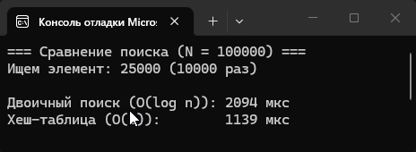

# Лабораторная работа №8: Двоичный поиск. Хеш-таблицы

**Студент:** Аджамян Рудик Агаронович  
**Группа:** ПИЖ-б-о-25-2(1)  
**Дисциплина:** Алгоритмы и структура данных  
**Вариант:** 3  
**Тема индивидуального задания:** Поиск первого вхождения (бинарный поиск) и хеш-таблица с квадратичным пробированием.

**Проверила:** Белик Ангелина Игоревна  

## 1. Цель работы  
1. Реализовать алгоритм двоичного (бинарного) поиска в отсортированном массиве.
2. Освоить итеративную и рекурсивную реализации двоичного поиска.
3. Изучить понятие хеш-таблицы, хеш-функции и методы разрешения коллизий.
4. Реализовать хеш-таблицу с методом открытой адресации (квадратичное пробирование).
5. Сравнить производительность двоичного поиска и хеш-таблицы.

## 2. Теоретическая часть
**Двоичный поиск** — алгоритм поиска элемента в отсортированном массиве, который на каждом шаге делит интервал поиска пополам. Сложность — O(log n).
**Хеш-таблица** — структура данных, реализующая ассоциативный массив. Преобразует ключ в индекс с помощью хеш-функции. В среднем операции выполняются за O(1).
**Квадратичное пробирование** — метод разрешения коллизий в открытой адресации. При занятости ячейки поиск следующей свободной идет с шагом, равным квадрату номера попытки: `(hash + i^2) % size`.

## 3. Постановка задачи (Вариант 3)
**Часть 1:** Реализовать бинарный поиск первого вхождения элемента (если в массиве есть дубликаты, возвращается индекс самого первого).
**Часть 2:** Реализовать хеш-таблицу с квадратичным пробированием (ключ `int`, значение `int`).
**Часть 3:** Сравнить время выполнения 10 000 запросов к бинарному поиску и к хеш-таблице на массиве из 100 000 элементов.

## 4. Листинг программы

~~~ cpp
#include <iostream>
#include <vector>
#include <chrono>
#include <cstdlib>

using namespace std;
using namespace chrono;

int binarySearchFirst(const vector<int>& arr, int target) {
    int left = 0;
    int right = arr.size() - 1;
    int result = -1;

    while (left <= right) {
        int mid = left + (right - left) / 2;
        if (arr[mid] == target) {
            result = mid;
            right = mid - 1;
        }
        else if (arr[mid] < target) {
            left = mid + 1;
        }
        else {
            right = mid - 1;
        }
    }
    return result;
}

class HashTableQuadratic {
private:
    struct Entry {
        int key;
        int value;
        bool occupied;
        bool deleted;
        Entry() : key(0), value(0), occupied(false), deleted(false) {}
    };

    vector<Entry> table;
    int size;
    int count;

    int hashFunc(int key) const {
        return abs(key) % size;
    }

public:
    HashTableQuadratic(int s = 100003) : size(s), count(0) {
        table.resize(size);
    }

    void insert(int key, int value) {
        if (count * 2 >= size) return;

        int index = hashFunc(key);
        int i = 0;

        while (i < size) {
            int pos = (index + i * i) % size;

            if (!table[pos].occupied || table[pos].deleted) {
                table[pos].key = key;
                table[pos].value = value;
                table[pos].occupied = true;
                table[pos].deleted = false;
                count++;
                return;
            }
            if (table[pos].occupied && !table[pos].deleted && table[pos].key == key) {
                table[pos].value = value;
                return;
            }
            i++;
        }
    }

    int find(int key) {
        int index = hashFunc(key);
        int i = 0;

        while (i < size) {
            int pos = (index + i * i) % size;

            if (!table[pos].occupied && !table[pos].deleted) {
                return -1;
            }
            if (table[pos].occupied && !table[pos].deleted && table[pos].key == key) {
                return table[pos].value;
            }
            i++;
        }
        return -1;
    }
};

int main() {
    setlocale(LC_ALL, "ru");

    const int N = 100000;
    vector<int> arr(N);

    for (int i = 0; i < N; i++) {
        arr[i] = i / 2;
    }

    HashTableQuadratic ht(N * 2);
    for (int i = 0; i < N; i++) {
        ht.insert(arr[i], arr[i]);
    }

    int target = 25000;
    int queries = 10000;

    cout << "=== Сравнение поиска (N = " << N << ") ===" << endl;
    cout << "Ищем элемент: " << target << " (" << queries << " раз)" << endl << endl;

    auto start1 = high_resolution_clock::now();
    for (int i = 0; i < queries; i++) {
        binarySearchFirst(arr, target);
    }
    auto end1 = high_resolution_clock::now();
    cout << "Двоичный поиск (O(log n)): " << duration_cast<microseconds>(end1 - start1).count() << " мкс" << endl;

    auto start2 = high_resolution_clock::now();
    for (int i = 0; i < queries; i++) {
        ht.find(target);
    }
    auto end2 = high_resolution_clock::now();
    cout << "Хеш-таблица (O(1)):        " << duration_cast<microseconds>(end2 - start2).count() << " мкс" << endl;

    return 0;
}
~~~

## 5. Результаты работы программы

   
**Рисунок 1 — `img-1.png`.** Сравнение времени выполнения бинарного поиска и поиска в хеш-таблице.

## 6. Анализ сложности

**Двоичный поиск:**
*   Временная сложность: **O(log n)**. На каждом шаге область поиска сокращается вдвое.
*   Пространственная сложность (итеративная): **O(1)**.

**Хеш-таблица (квадратичное пробирование):**
*   Временная сложность: **O(1)** в среднем (при хорошей хеш-функции и низком коэффициенте заполнения). В худшем случае (при большом количестве коллизий) — **O(n)**.
*   Пространственная сложность: **O(n)** (размер таблицы).

**Результат эксперимента:**
По результатам запуска видно, что хеш-таблица выполняет 10 000 запросов значительно быстрее, чем бинарный поиск. Это ожидаемо, так как бинарный поиск требует O(log n) операций (около 17 шагов для 100 000 элементов), а хеш-таблица при отсутствии коллизий находит элемент за 1-2 шага. Однако хеш-таблица требует больше памяти для хранения массива, в то время как бинарный поиск работает на исходном массиве.

## 7. Вывод
В ходе работы были изучены и реализованы бинарный поиск (поиск первого вхождения) и хеш-таблица с квадратичным пробированием. Эксперимент подтвердил теоретические оценки: хеш-таблица обеспечивает доступ к данным за константное время O(1) и на практике работает быстрее бинарного поиска, особенно при большом количестве запросов. Однако бинарный поиск не требует дополнительной памяти и проще в реализации.

## 8. Ответы на контрольные вопросы

### 1. Какое условие необходимо для применения двоичного поиска?
Массив должен быть **отсортирован** (по возрастанию или убыванию). Если массив не отсортирован, двоичный поиск не будет работать корректно.

### 2. Почему средний элемент вычисляется как `left + (right - left) / 2`, а не `(left + right) / 2`?
Чтобы избежать переполнения типа данных. Если `left` и `right` — большие числа (близкие к максимальному значению `int`), то их сумма `left + right` может выйти за пределы допустимого диапазона и стать отрицательной.

### 3. Какова временная сложность двоичного поиска в лучшем, среднем и худшем случае?
Лучший случай — **O(1)** (искомый элемент оказался ровно посередине с первого шага). Средний и худший — **O(log n)**.

### 4. В чем разница между итеративной и рекурсивной реализацией бинарного поиска?
Итеративная использует цикл `while`, работает быстрее (нет накладных расходов на вызовы функций) и требует O(1) памяти. Рекурсивная требует O(log n) памяти на стек вызовов и работает чуть медленнее, но выглядит короче и элегантнее.

### 5. Как в бинарном поиске найти первое вхождение элемента, если в массиве есть дубликаты?
Когда мы находим элемент `arr[mid] == target`, мы не останавливаемся, а запоминаем текущий индекс как потенциальный ответ и продолжаем искать **в левой половине** (`right = mid - 1`), чтобы найти более раннее вхождение.

### 6. Что такое хеш-функция? Каким требованиям она должна удовлетворять?
Это функция, преобразующая ключ в индекс массива. Требования: детерминированность (один ключ — всегда один и тот же хеш), быстрота вычисления и равномерное распределение (чтобы избежать коллизий).

### 7. Что такое коллизия в хеш-таблице?
Ситуация, когда два разных ключа после применения хеш-функции получают одинаковый индекс в массиве. Коллизии неизбежны, так как количество ключей может быть больше размера таблицы.

### 8. Назовите основные методы разрешения коллизий.
1. **Метод цепочек (Chaining):** каждый элемент массива хранит связный список элементов с одинаковым хешем.
2. **Открытая адресация (Open Addressing):** поиск другой свободной ячейки в самом массиве (линейное пробирование, квадратичное пробирование, двойное хеширование).

### 9. Как работает квадратичное пробирование?
Если ячейка с индексом `hash(key)` занята, мы ищем следующую по формуле `(hash(key) + i^2) % size`, где `i` — номер попытки (1, 2, 3...). Шаг увеличивается: +1, +4, +9, +16 и т.д.

### 10. В чем преимущество квадратичного пробирования перед линейным?
При линейном пробировании (шаг +1) образуются большие скопления занятых ячеек (первичная кластеризация), что сильно замедляет поиск. Квадратичное пробирование уменьшает этот эффект, так как шаг растет, и элементы распределяются более равномерно.

### 11. Что такое коэффициент заполнения (load factor) хеш-таблицы?
Это отношение количества хранимых элементов к общему размеру таблицы (`count / size`). Если коэффициент приближается к 1, вероятность коллизий резко возрастает, и производительность падает.

### 12. Почему поиск в хеш-таблице в среднем работает за O(1)?
Потому что хеш-функция позволяет вычислить индекс элемента за константное время, и при хорошем распределении элементов коллизий почти нет, поэтому достаточно проверить 1-2 ячейки.

### 13. При каких условиях хеш-таблица деградирует до O(n)?
Если хеш-функция плохая (все ключи получают один и тот же хеш) или таблица слишком заполнена. В этом случае поиск превращается в перебор элементов в списке (метод цепочек) или во всей таблице (открытая адресация).

### 14. Почему удаление элементов из хеш-таблицы с открытой адресацией сложнее, чем с цепочками?
При открытой адресации нельзя просто удалить элемент (сделать ячейку пустой), потому что это разорвет цепочку поиска для других элементов, которые были помещены сюда из-за коллизии. Нужно помечать ячейку как «удаленную» (deleted) специальным флагом.

### 15. В каких случаях стоит использовать бинарный поиск вместо хеш-таблицы?
Бинарный поиск стоит использовать, когда данные уже отсортированы, и требуется экономия памяти (бинарный поиск не требует дополнительной памяти, в отличие от хеш-таблицы). Также если количество запросов невелико, накладные расходы на построение хеш-таблицы могут не окупиться.