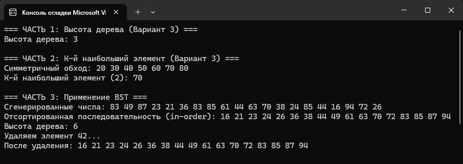

# Лабораторная работа №9: Бинарное дерево. Обходы. BST

**Студент:** Аджамян Рудик Агаронович  
**Группа:** ПИЖ-б-о-25-2(1)  
**Дисциплина:** Алгоритмы и структура данных  
**Вариант:** 3  
**Тема индивидуального задания:** Вычисление высоты дерева, поиск k-го наибольшего элемента в BST.

**Проверила:** Белик Ангелина Игоревна  

## 1. Цель работы  
1. Реализовать структуру данных «бинарное дерево» и изучить различные способы его обхода.
2. Реализовать бинарное дерево поиска (BST) с операциями вставки, удаления и поиска.
3. Освоить применение рекурсии для работы с деревьями.
4. Проанализировать сложность операций в BST.
5. Научиться вычислять характеристики дерева (высоту) и решать нестандартные задачи (поиск k-го элемента).

## 2. Теоретическая часть
**Бинарное дерево** — иерархическая структура данных, где каждый узел имеет не более двух потомков (левого и правого).
**Бинарное дерево поиска (BST)** — это бинарное дерево, в котором для каждого узла выполняется условие: все ключи в левом поддереве меньше ключа узла, а в правом — больше. Это позволяет искать элементы за O(log n).
**Обходы дерева:** прямой (pre-order), симметричный (in-order), обратный (post-order) и уровневый (level-order). Симметричный обход BST выдает элементы в отсортированном порядке.

## 3. Постановка задачи (Вариант 3)
**Часть 1:** Реализовать бинарное дерево с обходами (pre, in, post) и вычислить его высоту.
**Часть 2:** Реализовать BST (вставка, поиск, in-order) с дополнительным заданием — найти k-й наибольший элемент.
**Часть 3:** Создать BST из последовательности случайных чисел (N = 20), вывести отсортированную последовательность, найти высоту, удалить элемент.

## 4. Листинг программы
~~~cpp
#include <iostream>
#include <queue>
#include <vector>
#include <cstdlib>
#include <ctime>

using namespace std;

struct Node {
    int data;
    Node* left;
    Node* right;
    Node(int val) : data(val), left(nullptr), right(nullptr) {}
};

class BST {
private:
    Node* root;

    Node* insert(Node* node, int key) {
        if (node == nullptr) return new Node(key);
        if (key < node->data) node->left = insert(node->left, key);
        else if (key > node->data) node->right = insert(node->right, key);
        return node;
    }

    Node* search(Node* node, int key) {
        if (node == nullptr || node->data == key) return node;
        if (key < node->data) return search(node->left, key);
        return search(node->right, key);
    }

    Node* findMin(Node* node) {
        while (node->left != nullptr) node = node->left;
        return node;
    }

    Node* remove(Node* node, int key) {
        if (node == nullptr) return nullptr;
        if (key < node->data) node->left = remove(node->left, key);
        else if (key > node->data) node->right = remove(node->right, key);
        else {
            if (node->left == nullptr && node->right == nullptr) {
                delete node;
                return nullptr;
            } else if (node->left == nullptr) {
                Node* temp = node->right;
                delete node;
                return temp;
            } else if (node->right == nullptr) {
                Node* temp = node->left;
                delete node;
                return temp;
            } else {
                Node* minNode = findMin(node->right);
                node->data = minNode->data;
                node->right = remove(node->right, minNode->data);
            }
        }
        return node;
    }

    void inOrder(Node* node) {
        if (node == nullptr) return;
        inOrder(node->left);
        cout << node->data << " ";
        inOrder(node->right);
    }

    int getHeight(Node* node) {
        if (node == nullptr) return 0;
        return max(getHeight(node->left), getHeight(node->right)) + 1;
    }

    void kthLargestUtil(Node* node, int k, int& count) {
        if (node == nullptr || count >= k) return;
        kthLargestUtil(node->right, k, count);
        count++;
        if (count == k) {
            cout << "K-й наибольший элемент (" << k << "): " << node->data << endl;
            return;
        }
        kthLargestUtil(node->left, k, count);
    }

    void destroy(Node* node) {
        if (node == nullptr) return;
        destroy(node->left);
        destroy(node->right);
        delete node;
    }

public:
    BST() : root(nullptr) {}
    ~BST() { destroy(root); }

    void insert(int key) { root = insert(root, key); }
    bool search(int key) { return search(root, key) != nullptr; }
    void remove(int key) { root = remove(root, key); }
    
    void printInOrder() { 
        inOrder(root); 
        cout << endl; 
    }

    int getHeight() { 
        return getHeight(root); 
    }

    void findKthLargest(int k) {
        int count = 0;
        kthLargestUtil(root, k, count);
    }
};

int main() {
    setlocale(LC_ALL, "ru");
    srand(time(0));

    cout << "=== ЧАСТЬ 1: Высота дерева (Вариант 3) ===" << endl;
    BST tree1;
    tree1.insert(50);
    tree1.insert(30);
    tree1.insert(70);
    tree1.insert(20);
    tree1.insert(40);
    tree1.insert(60);
    tree1.insert(80);
    cout << "Высота дерева: " << tree1.getHeight() << endl << endl;

    cout << "=== ЧАСТЬ 2: K-й наибольший элемент (Вариант 3) ===" << endl;
    cout << "Симметричный обход: ";
    tree1.printInOrder();
    tree1.findKthLargest(2);
    cout << endl;

    cout << "=== ЧАСТЬ 3: Применение BST ===" << endl;
    BST tree2;
    cout << "Сгенерированные числа: ";
    for (int i = 0; i < 20; i++) {
        int num = rand() % 100;
        cout << num << " ";
        tree2.insert(num);
    }
    cout << endl;

    cout << "Отсортированная последовательность (in-order): ";
    tree2.printInOrder();

    cout << "Высота дерева: " << tree2.getHeight() << endl;

    int toDelete = 42;
    cout << "Удаляем элемент " << toDelete << "..." << endl;
    tree2.remove(toDelete);
    cout << "После удаления: ";
    tree2.printInOrder();

    return 0;
}
~~~
## 5. Результаты работы программы

   
**Рисунок 1 — `img-1.png`.** Демонстрация высоты дерева, поиска k-го наибольшего элемента и работы с деревом из случайных чисел.

## 6. Анализ сложности операций в BST

*   **Вставка (`insert`)**: В среднем **O(log n)**, в худшем (вырожденное дерево) — **O(n)**.
*   **Поиск (`search`)**: В среднем **O(log n)**, в худшем — **O(n)**.
*   **Удаление (`remove`)**: В среднем **O(log n)**, в худшем — **O(n)**.
*   **Обход (in-order, pre-order, post-order)**: Всегда **O(n)**, так как нужно посетить каждый узел ровно один раз.
*   **Вычисление высоты**: **O(n)**, так как алгоритм рекурсивно проходит все узлы, чтобы найти самый длинный путь.
*   **Поиск k-го наибольшего**: **O(h + k)**, где h — высота дерева. В среднем **O(log n + k)**.

## 7. Вывод
В ходе работы были изучены структуры данных «бинарное дерево» и «бинарное дерево поиска». Реализованы рекурсивные алгоритмы вставки, поиска и удаления узлов (с обработкой всех трех случаев удаления). Освоены прямые и обратные обходы. Были решены дополнительные задачи: вычисление высоты дерева (рекурсивный подсчет глубины) и поиск k-го наибольшего элемента (обратный in-order обход). Эксперимент с генерацией случайных чисел показал, что BST автоматически сортирует данные при симметричном обходе.

## 8. Ответы на контрольные вопросы

### 1. Что такое бинарное дерево? Из каких элементов оно состоит?
Это иерархическая структура данных, состоящая из узлов. Каждый узел содержит данные и ссылки на левого и правого потомка. Состоит из корня (root), листьев (узлов без потомков) и внутренних узлов.

### 2. В чём отличие бинарного дерева от бинарного дерева поиска (BST)?
В обычном бинарном дереве нет правил распределения элементов (где левый, а где правый). В BST действует строгое правило: левый потомок всегда меньше родителя, а правый — больше. Это ускоряет поиск.

### 3. Какие существуют виды обхода бинарного дерева? В чём их особенности?
Pre-order (Корень-Левый-Правый) — используется для копирования дерева.
In-order (Левый-Корень-Правый) — выдает отсортированный список для BST.
Post-order (Левый-Правый-Корень) — используется для удаления дерева (сначала удаляются дети).
Level-order (по уровням) — обход в ширину с использованием очереди.

### 4. Какой обход даёт отсортированную последовательность для BST?
**Симметричный (in-order)**. Он посещает узлы в порядке: левое поддерево, текущий узел, правое поддерево.

### 5. Какова сложность операций поиска, вставки и удаления в BST? От чего она зависит?
В среднем **O(log n)**. Зависит от высоты дерева. Если дерево сбалансировано, высота равна log n. Если дерево вырождено в список (вставляли по порядку), высота равна n, и сложность падает до **O(n)**.

### 6. Что происходит с BST, если вставлять элементы в отсортированном порядке?
Дерево становится **вырожденным** (превращается в односвязный список). Высота становится O(n), и производительность всех операций падает до O(n), так как теряется главное преимущество дерева.

### 7. Какие три случая нужно рассмотреть при удалении узла из BST?
1. Узел — лист (просто удаляем).
2. У узла один потомок (заменяем узел его потомком).
3. У узла два потомка (находим минимальный в правом поддереве, копируем его значение в удаляемый узел, а затем рекурсивно удаляем тот минимальный узел).

### 8. Как найти наименьший элемент в BST? Наибольший?
Наименьший — идти от корня по левым потомкам (`while(node->left) node = node->left`). Наибольший — идти по правым.

### 9. Как вычислить высоту бинарного дерева рекурсивно?
Функция возвращает 0 для пустого узла (`nullptr`). Для остальных — возвращает 1 + максимум из высот левого и правого поддеревьев: `1 + max(height(left), height(right))`.

### 10. Что такое наименьший общий предок (LCA) двух узлов в дереве?
Это самый глубокий узел, который является предком для обоих заданных узлов. В BST его можно найти, сравнивая значения: если оба узла меньше текущего — идем влево, если больше — вправо, иначе текущий узел и есть LCA.

### 11. Как проверить, является ли бинарное дерево BST?
Нужно выполнить in-order обход и проверить, что полученная последовательность отсортирована по возрастанию. Либо рекурсивно передавать допустимый диапазон значений (min, max) для каждого узла.

### 12. Что такое сбалансированное дерево? Почему это важно для производительности?
Это дерево, у которого высота левого и правого поддеревьев отличается не более чем на 1 (AVL-дерево). Это важно, потому что гарантирует высоту O(log n) и, следовательно, быстрый поиск/вставку/удаление.

### 13. Как преобразовать несбалансированное BST в сбалансированное?
Сначала нужно сделать in-order обход и сохранить все элементы в отсортированный массив. Затем рекурсивно строить дерево, беря средний элемент массива в качестве корня.

### 14. Как восстановить дерево по массиву обхода (in-order + pre-order)?
Первый элемент в pre-order — всегда корень. Находим этот элемент в in-order. Все, что слева от него — левое поддерево, справа — правое. Рекурсивно повторяем процесс.

### 15. Как реализовать итеративный (не рекурсивный) обход бинарного дерева?
С помощью стека. Для in-order обхода: идем влево до конца, складывая узлы в стек. Когда дошли до nullptr, достаем узел из стека, выводим его, и переходим к его правому потомку.